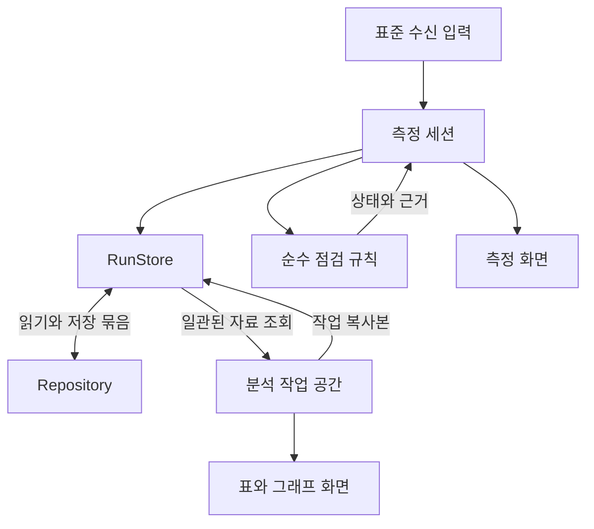

# 게이뤼삭 실험 초보자 모드 구현 설계

| 항목 | 내용 |
|---|---|
| 버전·작성일 | GL-DESIGN-v0.3 · 2026-10-13 정리 |
| 기준 기획 | [PLAN.md](PLAN.md)의 확정 결정 D1–D5와 초기 범위 |
| 경계·구현 원칙 | [ARCHITECTURE.md](ARCHITECTURE.md)의 소유권·의존 방향·라이브러리 선택 |
| 상태 | M1·M2와 M3 자료 표·분석 대상·계산 열·그래프·추세선/연장 저장 구현. 후속 범위와 검증 현황은 [README](README.md) 참조 |
| 읽는 순서 | [화면과 행동](#2-화면과-행동) → [상태 전환](#3-상태-전환) → [모듈과 데이터](#4-모듈-경계) → [구현 순서](#10-구현-순서와-완료-기준) |

이 문서는 화면에서 일어난 행동을 어떤 모듈이 처리하고, 자료와 상태를 어떻게 보존할지 정한다. 기능의 목적·범위·학생 문구와 실시간 점검의 초기 수치는 [기획안](PLAN.md)을 기준으로 한다.

> [!IMPORTANT]
> **화면·통신·실험 기록의 수명을 분리한다.** 안내 화면을 다시 열어도 기록은 이어지고, 연결이 끊겨도 같은 실험이 남는다. 분석은 원자료와 학생의 작업 설정을 구분해 보존한다.

## 1 구현 경계

- 정적 HTML·CSS·JavaScript ES 모듈로 시작한다. 현재 저장소의 실행 방식에 맞춰 `/gay-lussac/`를 독립 진입점으로 두고 해시 경로를 사용한다. 기존 앱의 시작 구조는 [`../js/app.js`](../js/app.js)에서 확인할 수 있다.
- 화면 뼈대부터 최종 앱과 같은 코드를 사용한다. 최초에는 일부 기능을 연결하지 않은 상태로 화면 흐름을 확인하고, M1–M4에서 해당 모듈을 순서대로 채운다.
- 현재 배선 3D·Bluetooth 통신·차트 자원을 필요한 경계에서 재사용한다. 하위 앱은 자체 실험 상태와 저장소를 소유한다.
- 기준 환경은 기획안의 노트북·Chrome/Edge·micro:bit V2 조합이다. 앱 시작 시 연결·저장 기능의 이용 가능 여부를 확인하고 해당 기능 가까이에 안내한다.
- 개발용 자료 재생은 같은 표준 수신 입력을 사용하되 별도 실험 ID와 `source=replay`를 붙인다. 실제 장치 수신과 실기 검증 여부를 구분한다. 저장 파일 가져오기는 검증한 실험 자료를 복원하는 별도 경로다.

## 2 화면과 행동

### 2.1 공통 틀

상단에 **기체의 온도와 압력**, 실험 이름, 연결·수신·저장 상태를 유지한다. 화면 중앙의 주된 내용과 하단의 행동만 준비·측정·분석에 맞춰 바꾼다. 상태 변화로 버튼 위치가 크게 이동하지 않도록 공간을 확보한다. 현재 실험 도구는 **다운로드 → 추가 측정 → 새 실험** 순서이며 다운로드는 청록색 강조 버튼으로 파일 형식 메뉴를 연다.

| 화면 | 넓은 화면의 기본 배치 | 주요 행동과 화면 반응 |
|---|---|---|
| 시작 | 실험 소개와 시작 행동, 저장된 실험 목록 | 처음부터 준비 / 장치가 준비되어 있어요 / 저장된 실험 열기 |
| 준비 | 왼쪽 약 2/3은 3D·전체 그림, 오른쪽은 현재 행동과 확인 | 한 번에 한 연결을 강조한다. 이전 단계와 **↺ 시점 초기화**를 가까이 둔다. |
| 측정 | 상단 온도·압력, 중앙 시간 그래프, 아래 조작 버튼 | 가열 시작·물 추가·장치 변화·측정 마치기를 같은 위치에서 사용한다. |
| 분석 | 전체 시간 그래프 → 관계 그래프 → 결과 해석의 자유 작업 메뉴 | 구간 선택, 즉시 축 변경, 추세선·추세선 연장, 표·계산 열과 목적별 저장. 도움말은 후속 범위 |

분석은 원 자료 보기·관계 그래프·결과 해석으로 자유롭게 이동한다. 기본 화면은 좌우 축 시간 그래프와 접힌 표다. 표는 넓은 화면에서 그래프 왼쪽에, 좁은 화면에서 아래에 펼친다. 결과 해석은 가져온 근거 그래프와 학생의 세 답변을 모아 보여 준다. 그래프 조작은 관계 화면에서 한다. 작업 상태와 측정 세션은 메뉴 이동에도 유지한다.

실험 이름 편집은 목록 안에서 입력칸·저장·취소로 전환하며 행 높이를 유지한다. 이름은 앞뒤 공백을 제거한 1~120자로 저장하고, 열린 실험의 상단 이름도 반영한다. 계산 열과 같은 연필 아이콘 자원을 사용한다. 저장은 RunStore의 기존 updateRun·flush와 작성 잠금을 재사용하며, 측정값·분석 정의는 변경하지 않는다.

저장된 실험의 삭제는 목록의 삭제 버튼 → 실험 이름을 표시한 확인창 → 삭제 순서다. 취소에 초기 초점을 두며 실행 중에는 중복 제출과 닫기를 막는다. 현재 실험을 삭제하면 열린 분석·세션과 마지막 실험 주소를 정리하고 시작 화면에 남는다. 측정 중·미저장·다른 탭 작성 중에는 삭제하지 않고, 실패하면 확인창에서 이유를 안내한다.

### 2.2 화면별 상태

| 상황 | 보여 줄 내용 | 행동 결과 |
|---|---|---|
| 장치 연결 전 | 연결할 장치 그림, 연결 버튼 | 사용자 클릭으로 장치 선택을 연다. |
| 앱 내부 USB 설치 | 온도·압력 측정 프로그램, 연결·전송 진행률, 완료·오류 | 공식 API가 완료된 뒤 **수신 확인하기**로 실제 수신을 확인한다. |
| 최초 수신 확인 | 새 온도·압력, 마지막 수신 시각 | 기록은 이미 준비 구간으로 시작된다. 배터리 전환과 용기 배치를 이어 안내한다. |
| 가열 전 | 준비 구간 그래프, **가열 시작** | 버튼을 누른 시각을 사건으로 남긴다. |
| 가열 중 | 같은 그래프와 조작 버튼, 필요한 점검 안내 | 물 추가·장치 변화는 측정을 계속하면서 기록한다. |
| 수신 중단 | 마지막 값과 시각, **다시 연결** | 오래된 숫자를 흐리게 표시하고 시간 그래프를 수신 시각의 공백에서 끊는다. |
| 측정 완료 | **측정 완료**, 마지막 측정값과 시각 | RunStore의 마지막 기록을 표시한다. 실시간 수신값으로 표시하거나 준비 화면의 수신 확인에 사용하지 않는다. |
| 저장 문제 | 미저장 자료 수, **다시 저장 / 파일로 보관** | 수신 자료를 메모리에 유지하고 저장을 재시도한다. |
| 분석 첫 진입 | 전체 온도·기압 시간 그래프와 접힌 표 | 전체 자료 또는 직접 고른 시간 구간으로 관계 그래프 이동. 세 작업 메뉴는 모두 접근 가능 |
| 분석 재진입 | 저장된 표·그래프 또는 자료와 축을 고르는 빈 화면 안내 | 첫 안내를 반복 자동 표시하지 않으며 **화면 안내 / 목표 힌트**는 언제든 열 수 있음 |
| 분석 자료 부족 | 필요한 자료나 축을 안내 | 사용할 수 있는 다른 도구는 계속 사용할 수 있다. |

마이크로비트 연결·해제 도구는 준비 5단계 **통신 연결** 안에 둔다. 배터리·측정 화면의 작은 통신 연결 버튼은 같은 5단계로 이동하며 기존 연결 핸들러를 공유한다. 준비 제목은 **하나씩 따라해 볼까요?**로 표시한다. 시점 초기화는 3D 화면 우측 상단에 겹쳐 두고 배선표·용기 그림에서는 숨긴다.

준비 단계 바는 클릭·키보드로 원하는 단계에 바로 이동하는 버튼으로 사용한다. 배선은 첫 연결 단계로 이동하고, 각 연결은 기존 이전·다음 버튼으로 살펴본다. 단계 이동은 연결·수신 확인 상태를 초기화하거나 완료로 처리하지 않는다. 프로그램 준비·USB 설치 작업 중에는 기존 이전·다음과 함께 단계 바도 잠시 비활성화한다. 분석 도구는 독립적으로 열리며, 힌트를 읽은 횟수나 답변 여부에 연결하지 않는다. 버튼·표 선택은 키보드로도 조작하고 상태는 글자로 함께 전달한다.

측정값 영역은 시간 그래프 패널 안에서 온도·압력·수신 상태를 나란히 표시한다. 숫자는 고정 폭 숫자 글꼴을 사용하고 짧은 수신 상태 전환은 같은 공간에서 갱신한다. 수신 문제는 마지막 수신 안내 자리에 표시하며 긴 안내는 줄바꿈으로 읽을 수 있게 한다. 760px 이하에서는 두 측정값 아래 한 줄에 수신 상태를 배치한다. 온도·압력 설명은 기존 공통 도움말 모듈을 재사용한다.

### 2.3 실험 방법 팝업

- 용기 배치 확인으로 측정 화면에 이동한 뒤 **실험 방법**을 연다. 화면 표시·초점 이동을 먼저 끝내고 모달 제목으로 초점을 옮긴다. 같은 실험에서 재진입하거나 추가 측정해도 자동 안내를 반복하지 않는다.
- 제목 옆 **실험 방법 보기**는 완료·미완료·연결 여부와 무관하게 사용할 수 있다. 직접 열어 본 이력도 같은 실험의 자동 표시를 생략하는 근거다.
- **다시 보지 않기**는 브라우저 공통 설정이며 수동 열기를 막지 않는다. 체크를 풀면 아직 열지 않은 실험에서 자동 표시를 다시 허용한다. 이력·설정은 localStorage에만 두며 파일이나 실험 DB에 포함하지 않는다. 저장소 접근 실패 시 현재 페이지의 메모리에서 유지한다.
- **측정하러 가기**, 닫기, Esc로 즉시 닫고 다시 보기 버튼으로 초점을 돌려준다. 화면을 떠날 때는 닫기만 하며 이전 화면에 초점을 되돌리지 않는다. 키보드 초점은 네이티브 dialog 안에 머문다.
- 본문은 **처음 값 / 데우기 / 변화 기록 / 자료 살피기** 네 페이지로 나눈다. 각 페이지는 해당 조작을 보여 주는 정지 일러스트와 구체적인 행동 설명을 한 쌍으로 둔다. 그림 속 버튼·스위치·손잡이는 실제 조작 요소가 아니다. 가열 시작이 시각 기록임을 설명하고, 물 추가·장치 변화·메모 추가/저장·전체/구간 분석·새 자료 반영을 실제 버튼 이름과 순서로 안내한다. 시작보다 센서 온도가 약 10℃ 높아질 때까지라는 관찰 목표·주의 기준 우선 적용·짧은 가열 주의는 데우기 페이지에만 둔다. 물의 양·물의 온도·시간의 정확한 수치를 지정하거나 결론을 대신 제시하지 않는다. 구체적인 문구 기준은 [PLAN §4.2](PLAN.md#42-최소-안내-상태)를 따른다.
- 하단 **이전 / 다음**과 상단 1–4 단계 버튼으로 이동한다. 처음에는 이전이 비활성이고 마지막의 다음은 **측정하러 가기**로 바뀌어 닫는다. 상단 단계 버튼은 좌우 방향키·Home·End로도 이동하며 방문 여부로 잠그거나 완료 표시하지 않는다. 현재 페이지 번호를 보조기기에 알리고 팝업을 다시 열면 첫 페이지부터 보여 준다. 페이지 선택은 뷰의 임시 상태이며 실험 기록을 만들지 않는다.
- 팝업 크기와 단계·하단 버튼 위치는 페이지를 넘겨도 유지한다. 작은 화면은 그림 아래에 설명을 놓고 본문만 세로로 스크롤하며 제목·단계·닫기·하단 버튼은 유지한다. 페이지를 넘기면 본문 스크롤을 맨 위로 돌린다. 등장과 페이지 전환의 짧은 이동·페이드는 동작 줄이기 설정에서 생략한다. 실제 수신 중이고 기록 가능한 때만 안내 중 기록이 계속된다는 보조 문구를 표시한다.
- 열기·닫기·표시 설정은 Session·RunStore·Workspace를 수정하지 않는다. 가열 시작·물 추가 등은 기존 측정 버튼으로 기록한다.

## 3 상태 전환

### 3.1 따로 관리할 상태

| 상태 | 값 | 소유자 |
|---|---|---|
| 화면 | `home / prepare / measure / analysis` | 앱 제어기 |
| 실행 중 기록 | `idle / collecting / paused / finishing / ended` | 측정 세션 |
| Bluetooth | `disconnected / connecting / connected` | 통신 어댑터 |
| USB 설치 | `idle / loading / ready / connecting / flashing / success / cancelled / error / unavailable` | 프로그램 전송 어댑터 |
| 유효값 수신 | `waiting / receiving / stale` | 규칙이 계산하고 측정 세션이 상태 보관 |
| 저장 | `clean / pending / saving / error` | 열린 실험의 RunStore |
| 저장된 실험 | `open / paused / complete / interrupted` | RunStore가 변경을 관리하는 `Run` 레코드 |

예를 들어 `Bluetooth=connected`, `수신=stale`, `저장=clean`이 동시에 가능하다. 화면에는 **장치는 연결되어 있지만 새 값이 들어오지 않음**, **지금까지의 자료는 저장됨**을 각각 표현한다.

### 3.2 전환 규칙

| 행동·사건 | 처리 |
|---|---|
| 새 실험 준비 | 실험 ID를 만들고 작성 권한을 확보한다. 준비 단계와 프로그램 후보 정보를 저장한다. |
| 최초 유효값 | 준비 구간부터 `collecting`으로 기록한다. 앞서 수신한 형식 오류는 오류 사건으로 남길 수 있다. |
| 안내 다시 보기 | 화면만 바꾼다. 세션·수신 콜백·저장 대기열을 유지한다. |
| 가열 시작 | `heating-start`를 한 번 기록한다. 버튼 중복 입력으로 사건을 복제하지 않는다. |
| 연결 해제 | 통신 자원을 정리하고 연결 해제 사건을 기록한다. 기록 세션은 이어 연결할 수 있는 상태로 유지한다. |
| 같은 실험에 다시 연결 | 마지막 샘플 ID 다음부터 수신 시각과 함께 기록한다. 재연결을 새 실험으로 처리하지 않는다. |
| 기록 일시정지 | `paused`로 바꾸고 정지 사건을 저장한다. 연결·현재 값은 유지하되 새 수치와 형식 오류를 원자료·사건에 추가하지 않는다. 물 추가·장치 변화의 사용자 메모는 기록할 수 있다. |
| 기록 재개 | 정지 전 자료를 유지하고 새 수신값부터 이어 기록한다. 정지 중 표시값을 소급 저장하지 않는다. |
| 측정 마치기 | 입력을 먼저 마감해 `finishing`으로 바꾸고 종료 사건·남은 자료·완료 상태를 저장한다. 성공 또는 임시 분석 선택 후 `ended`로 이동한다. |
| 기록 중 분석 경로 진입 | 기록을 유지하고 추가 자료 건수와 **새 자료 반영**을 제공한다. 표 갱신과 분석 범위 적용은 §7.1에 따라 구분한다. 화면 이동만으로 정지·종료하지 않는다. |
| 새로고침 후 미완료 기록 열기 | 저장된 부분을 보여 주고 **이어 측정 / 여기까지 분석**을 제공한다. 잠금 확보 후 중단 상태를 기록한다. |
| 일시정지된 실험 다시 열기 | 작성 권한이 있으면 `paused` 세션을 복원한다. 연결해도 미리보기만 제공하며 **기록 재개**를 눌러야 기록한다. |
| 완료된 실험 다시 열기 | **측정 완료**와 **추가 측정**을 표시한다. 작성 권한과 기존 자료의 저장 완료를 확인하고, 체크리스트 제출 뒤 같은 실험을 `open`으로 바꾼다. |

기록 중 다른 실험을 열거나 새 실험으로 바꾸려면 먼저 현재 측정을 마친다. 미저장 자료가 있는 경우 해당 RunStore를 유지하거나 저장·내보내기를 처리한 뒤 바꾼다. 앱 제어기는 화면을 교체하면서 세션이나 RunStore를 폐기하지 않는다.

## 4 모듈 경계

### 4.1 자료 흐름

**RunStore**는 열린 실험의 자료·저장 상태를 관리하는 단일 창구이고, **Repository**는 실제 IndexedDB 접근을 맡는다. 저장된 자료와 미저장 자료의 병합은 RunStore만 수행한다. 앱 제어기는 모듈을 연결하고 종료·화면 전환 순서를 조율한다.

### 4.2 최소 모듈 계약

아래는 현재 핵심 모듈의 공개 계약이다. 같은 책임을 유지하는 범위에서 파일 내부의 작은 함수를 나눌 수 있다. 전역 이벤트 시스템이나 플러그인 등록 체계는 초기 구조에 필요하지 않다.

| 위치·모듈 | 주요 계약 | 소유하는 상태 |
|---|---|---|
| `app.js` | `openRun(id)`, `navigate(screen)`, `finishAndAnalyze()` | 현재 화면, 세션·RunStore·화면의 참조와 호출 순서 |
| `guide/steps.js`, `guide/viewer-adapter.js` | `getStep(id)`, `applyStep(step)`, `restoreStep()` | 안내 단계와 모델 표시 상태 |
| `measurement/transport.js` | `connect(profile, onInput, onState, { reuseDevice })`, `disconnect()`, `forgetDevice()` | 장치, 연결 시도 번호, 시작 명령 재시도와 수신 정리 |
| `measurement/decoder.js` | `decode(line, profile)` | 내부 상태 없이 수치·필드별 유효성 또는 형식 오류 반환 |
| `measurement/controller.js` | `acceptInput()`, `tick()`, `start()`, `dispose()`, `confirmBattery()`, `markEvent()` | 화면과 독립된 평가 일정·준비 진도 확인의 호출 순서. 활성 세션은 주입받으며 화면 전환 시 교체하지 않음 |
| `measurement/actions.js` | `measurementActions(context)`, `readingStatus(snapshot, connection)` | 숨은 상태 없이 행동 가능 여부·수신 준비 여부 반환. 버튼과 명령이 공유 |
| `ui/experiment-view.js` | `render(model)`, `renderProgram()`, `renderStorage()`, `renderChart()`, `dispose()` | 연결·측정·저장 DOM, 차트 자원과 표시 주기. 세션·진도·저장 수정 없음 |
| `measurement/session.js` | `acceptInput(input)`, `markEvent(type, payload)`, `pause()`, `resume()`, `startAdditional()`, `finish()` | 샘플 번호·수신 시각, 기록 정지·재개·입력 마감, 규칙별 상태와 `tick()` 평가 |
| `diagnostics/` | `step(previousState, input, now, config)` | 숨은 상태 없이 `nextState`와 관측 결과 반환 |
| `data/run-store.js` | `appendSample()`, `appendEvent()`, `updateEventNote()`, `saveWorkspace()`, `flush()`, `getSnapshot()` | 열린 Run, 사건 ID 할당, 미저장 복사본, 저장 상태·일정·작성 잠금 |
| `data/repository.js` | `open()`, `readRun()`, `readSamples()`, `readEvents()`, `readWorkspace()`, `commitBatch()` | DB 연결·스키마·인덱스·트랜잭션 |
| `analysis/workspace-state.js` | `restoreWorkspace(value, { runId, samples, imported })` | 로컬 저장·JSON에 공통인 구형 작업 이행과 검증. 입력을 수정하지 않음 |
| `analysis/calculation-dependencies.js` | `axisCalculations(graph, columns)` | 기본 축을 포함한 전이 계산 의존 열 탐색. 입력 revision과 근거 캡처에 공통 사용 |
| `analysis/time-series.js` | `timeGraphData()`, `breaksTimeLine()` | 시간 그래프 좌표·유효성·사건 표시 모델과 시간선 공백/역행 판정 |
| `analysis/workspace.js` | `getViewModel()`, `getRows()`, `getSummary()`, `selectRange()`, `setFilter()`, `setSort()`, `applyScope()`, `exclude()`, `restore()`, `undo()`, `redo()` | 표 범위·체크·후보·제외, 작업·분석 입력 revision, 열린 작업의 이력 |
| `analysis/calculations.js` | `createCalculator()`, `calculateValue()`, `presetColumns()` | 숨은 상태 없이 계산 결과·이유 반환, 기본 계산도 같은 정의 사용 |
| `analysis/regression.js` | `linearFit()`, `fitGraph()`, `trendGeometry()` | 회귀 계수·수치 유효성·초 단위 시간축 변환·실선/연장선 좌표. DOM·저장소 독립 |
| `data/files.js` | `buildCsv(snapshot)`, `buildAnalysisCsv(snapshot, columnIds)`, `buildExperimentJson(snapshot)`, `parseExperimentJson(text)`, `parseExperimentCsv(text, options)` | CSV·JSON 형식 변환, 분석 범위와 계산 값 투영 |
| `data/import-validation.js`, `data/import-run.js` | `validateExperimentSnapshot()`, `importRun()` | 입력 검증·충돌 ID 교체·출처 보존·신규 실험의 원자적 저장 |
| `ui/file-controls.js` | `createFileControls()` | 다운로드 메뉴·계산 열 선택·CSV/JSON 파일 선택, 주입받은 스냅샷·가져오기 행동 연결 |
| `ui/analysis-view.js` | `open(store)`, `updateStatus()`, `reset()`, `dispose()` | 분석 화면·입력과 모듈 연결 |
| `ui/data-table.js`, `ui/table-header.js`, `ui/column-filters.js` | 표 `render()`·`dispose()`, 헤더 `render()`·`columnCount`, 필터 팝업 `close()` | 행·가상 스크롤 / 열 배치·헤더 조작 / 필터 입력 초안을 각각 소유 |
| `ui/chart-view.js` | 측정 `render(model)`과 분석 `render(model, selectedIds)`, `dispose()`, `exportAnalysisPng(model)` | 측정·분석 canvas·라이브러리 인스턴스·고정 크기 PNG |

공통 레코드와 입력 계약은 `data/contracts.js`의 JSDoc·검증 함수로 시작한다. 의존 방향과 외부 도구 경계는 [구현 원칙 §3](ARCHITECTURE.md#3-의존-방향과-외부-도구의-경계)을 따른다. 화면은 사용자 행동을 전달하고 결과를 표시하며, 저장과 점검은 화면의 단계 번호를 입력 조건으로 사용하지 않는다. PNG의 실제 다운로드 요청은 작은 `ui/download.js`가 처리한다.

`getViewModel()`은 표 행·요약·불러온 샘플·현재 그래프를 한 번의 화면 갱신에 제공한다. 표와 결과 해석은 전달받은 모델을 사용한다. 시간 그래프 자료 변환은 `timeGraphData()`가 담당하며 차트 어댑터는 표시·좌표 변환·PNG만 맡는다.

RunStore의 생성·열기는 저장된 상태를 읽고 작성 권한을 확보한다. 메타데이터 변경은 `updateRun(patch)`로 전달해 revision을 갱신하며, `close()`는 저장·미저장 자료 처리를 마친 뒤 잠금과 저장 일정을 해제한다.

## 5 3D 안내와 장치 연결

### 5.1 기존 3D의 최소 통합

[`../bmp280-wiring/index.html`](../bmp280-wiring/index.html)을 같은 출처의 iframe으로 한 번 생성해 유지한다. 구현 시 기존 페이지에 `embed=1` 표시 모드와 작은 `embed-bridge.js`를 추가한다. 이 파일은 기존 번들 바깥에서 정해진 UI 연결 지점만 호출한다.

| 기존 연결 지점 | 적용 방법 |
|---|---|
| `[data-view]`의 `iso/front/back/top/ports` | 준비 단계별 기본 시점을 적용한다. |
| `[data-wire]`의 `vcc/gnd/scl/sda` | 해당 선만 강조한다. 기존 동작은 토글이므로 이미 선택된 선을 다시 눌러 해제하지 않도록 현재 상태를 확인한다. |
| `#all-wires`, `#explode` | 전체 선 표시와 분리 정도를 명시적인 값으로 적용한다. |
| `#inspect-connectors` | 단자 확대와 분리값 변경이 함께 일어나는 동작으로 취급한다. |
| `#reset` | 전체 초기화에 사용한다. **↺ 시점 초기화**는 현재 단계의 시점·강조·분리값을 다시 적용한다. |

임베드 모드는 기존 제목·사이드바의 표시만 조정하고 필요한 DOM은 유지한다. 프레임과 3D 영역의 높이를 정해 모델을 크게 표시한다. 일반 주소의 독립 안내도 계속 사용할 수 있도록 변경 범위를 한정한다.

<strong>새로 추가할 프레임 메시지 계약</strong>

- 메시지는 `channel: "gay-lussac-guide"`, `version: 1`, `type`, `requestId`를 갖는다.
- 부모의 준비 요청에 프레임은 `ready`를 응답한다. 단계 적용은 `apply-state`와 `{view, wire, explosion}`만 허용하고 `applied` 또는 `error`로 응답한다.
- `view`는 `iso/front/back/top/ports/connector`를 허용한다. `connector`는 `#inspect-connectors`에 대응하며 `explosion=60`인 상태로만 요청한다. 다른 시점은 해당 `[data-view]`에 대응한다.
- `wire`는 `null/vcc/gnd/scl/sda`를 허용한다. `null`은 **전체 배선 표시·강조 없음**이며 `#all-wires`에 대응한다. 특정 선은 전체 표시 상태에서 해당 선을 선택한다. `explosion`은 기존 모델 범위인 0–60으로 제한한다.
- 양쪽은 발신 출처와 상대 창을 확인한다. 임의 선택자·함수명·스크립트를 메시지로 받지 않는다. 부모는 마지막 요청과 다른 응답을 현재 단계 완료로 처리하지 않는다.
- 표시 적용 완료는 실제 배선 완료를 뜻하지 않는다. 실제 조작은 사용자가 확인한다.
- 자유 회전 뒤 **↺ 시점 초기화**는 동일한 `apply-state`를 다시 보낸다. 프레임 통신·WebGL 이용이 어려우면 같은 단계의 정지 그림·연결표를 제공한다.

현재 모델의 `ports` 시점은 USB·전지 단자를 함께 보여 준다. 개별 포트 확대, 배선 양끝에 맞춘 카메라 이동, 부드러운 전환은 필요한 부분부터 추가할 작업이다. 현재 코드에 외부 제어 API가 이미 있다고 가정하지 않는다. 용기·수조·고정 장치 안내는 기획안대로 별도 전체 그림으로 보완한다.

시작 화면과 마지막 용기 배치 단계는 같은 `assets/setup.svg`를 재사용한다. micro:bit·확장 보드와 배터리는 밀폐 용기 바닥에, 센서는 중간 높이의 공기 중에 두고 모든 배선을 내부에 그린다. 뚜껑을 통과하는 USB·센서 선 없이 Bluetooth 무선 전송을 표시한다. 물과 고정 장치는 용기 외부에만 표시한다. 이 그림은 [참고 장치 기록](https://github.com/Cho-WH/Gay-Lussac/blob/main/experiments/pressure-temperature/runs/20260822-01.md)과 후속 고정 계획을 반영한 배치 개념도이며 제품의 정확한 치수·배터리 수량을 지정하는 도면은 아니다.

그림의 표기는 부품 이름과 ‘유리 밀폐 용기’로 간소화한다. 아래에는 ‘센서는 벽에 닿지 않고 최대한 용기 중앙에 떠 있도록 하세요.’만 안내하고 가느다란 화살표로 센서를 가리킨다. 그림 밖에 같은 배치 설명을 캡션으로 반복하지 않는다.

준비 그림의 도구는 상단에 모은다. 준비물·배선 단계에는 **3D 보기 / 배선표 보기**를 제공하고, **↺ 시점 초기화**는 3D 표시 중에만 보인다. **크게 보기**는 기존 독립 배선 안내를 연다. 하단 도구 영역과 회전·확대 힌트는 두지 않는다. 용기 배치에서는 도구를 숨기되 도구·그림의 공간은 유지한다. 배선표는 역할·확장 보드·BMP280의 네 연결 행으로 구성하며 현재 행을 색상과 글자로 표시한다. 보기 전환과 현재 행 변경에도 그림 영역·행 높이는 유지한다. 3D 표시 실패 시 배선표와 실패 안내를 제공한다.

불러오기 상태는 그림 안에 절대 배치하여 별도 줄을 만들지 않는다. 안내 영역에는 내부 스크롤을 만들지 않는다. `ui/guide-view.js`가 실제 화면과 같은 텍스트 렌더링 함수로 배선 설명의 비활성·비노출 측정 요소를 만들고, `ui/guide-layout.js`가 현재 폭에서 네 단계의 자연 높이를 측정한다. 설치·수신 조작 영역은 복제하지 않는다. 가장 큰 값을 배선 단계의 공통 최소 높이로 확보하며 다른 단계는 각 내용 바로 아래에 완료 버튼을 둔다. 폭·글꼴 변경 시 재측정하며 수신·로딩 갱신마다 높이를 바꾸지 않는다. 예상보다 긴 오류는 잘라 숨기지 않고 자연스럽게 펼친다. 배선표도 자연 높이에 맞춰 그림 영역의 최소 높이를 확보한다. 좁은 화면에서는 도구 모음 두 줄의 공간을 미리 확보한다. 프로그램 전송 진행률·수신 확인 문구·배선표의 현재 단계 표시도 공간을 확보한다.

단계 바는 하나의 선택 밑줄이 현재 단계로 300ms 동안 미끄러지듯 이동한다. 오른쪽 설명은 이동 방향에 따라 20px 옆에서 제자리로 들어오는 300ms 슬라이드와 약한 투명도 전환을 적용한다. 모델·그림에는 페이드를 적용하지 않고 완료 버튼은 전환 효과에서 제외한다. 같은 단계의 수신 갱신에는 효과를 반복하지 않고 빠르게 이동하면 이전 효과를 취소한다. `prefers-reduced-motion: reduce`에서는 두 전환 효과를 생략한다.

### 5.2 공식 전송과 실제 수신

기획안의 [공식 USB 전송 경로](PLAN.md#3-3d-장치-준비와-공식-usb-전송)를 그대로 사용한다. `program-config.js` 한 곳에서 HEX 경로·표시 이름·버전·해시·센서 프로파일·검증 상태를 관리한다. HEX 원본 파일과 Git 줄바꿈 설정은 변경하지 않는다. UTF-8을 엄격히 읽고 CRLF만 LF로 통일한 내용의 SHA-256을 검증한 뒤 같은 내용을 공식 V2 HEX 처리기에 전달한다. 기준 해시는 이 정규화 규칙을 따른다. 공식 microbit-universal-hex 0.2.2의 `splitHex()`가 CR을 제거해 줄을 해석하는 동작을 참고하되, 앱의 검증은 단독 CR·공백·빈 줄·BOM을 제거하지 않는다. 이는 앱의 해시 검증 정책이며 공식 라이브러리의 해시 권고로 간주하지 않는다. 현재 HEX는 실제 V2에서 설치·온도/압력 수신·배터리 동작을 확인한 `communication-verified` 상태다. 검증한 환경과 한계는 README에 기록하며 센서 정확도 검증과 구분한다.

`guide/programmer-adapter.js`가 공식 라이브러리의 USB 객체·준비한 HEX·전송 상태를 소유한다. 프로그램 단계에 들어오면 파일을 읽어 SHA-256과 V2용 HEX를 확인한다. 준비가 끝난 설치 버튼에서 다른 비동기 작업을 기다리기 전에 공식 `connect()`를 호출한다. 최초 장치 선택은 브라우저 권한 흐름을 따른다. V2 확인 후 앱이 제공한 `beforeFlash`에서 BLE를 해제하고 `flash(source, { partial: false, progress })`로 전체 전송한다. `flash()`가 성공으로 끝나야 완료 상태가 되며 진행률 100%는 완료 근거가 아니다. 취소·실패 모두 USB 점유를 해제하고 중복 설치를 막는다. 공식 객체는 어댑터 밖으로 내보내지 않는다.

설치 중에는 Bluetooth 연결과 이전·다음 단계 버튼을 막고, 다른 화면에서도 설치 진행 안내를 유지한다. 화면 전환은 전송 객체를 해제하지 않는다. 새로고침·닫기는 브라우저 확인을 요청하며 문서를 떠날 때 정리한다. 같은 페이지에서 선택한 장치를 기억하지만 새 페이지에서는 다시 선택한다. 앱은 전송 성공과 별도로 **새로운 유효값 3개가 1초 이상에 걸쳐 수신됨**을 확인하고, 배터리 전환 후 그 시점 이후의 값으로 다시 확인한다.

`transport.js`는 기존 [`../js/bluetooth.js`](../js/bluetooth.js)의 장치 선택·연결·알림·`bme` 명령·정리를 감싼다. 기존 연결 화면에 있는 첫 값 대기와 제한된 시작 명령 재시도는 세션과 분리해 옮긴다. 현재 기준인 첫 값 대기 3초, 명령 간격 300ms·최대 5회를 연결 설정으로 관리하고 M1 실기에서 적합성을 확인한다. [기존 연결 구현](../js/ui/connection-panel.js)

어댑터는 decoder의 결과를 `reading / parse-error` 입력으로 내보내고, 연결 시도 ID·UTC 수신 시각·단조 시각을 함께 전달한다. 파싱 가능한 범위 밖 수치도 `reading`에 남긴다. 시작 명령 재시도는 프로파일상 유효한 첫 Reading을 받으면 종료하며, 안내의 3개·1초 확인과 구분한다.

연결 시도 번호가 지난 응답·콜백·재시도를 무시하고, 종료 시 타이머와 알림을 정리한다. 연결 객체는 통신 어댑터가 소유하며 기존 전역 `state.history`나 연결 UI의 초기화 함수를 새 기록의 저장소로 사용하지 않는다.

## 6 데이터와 저장 계약

### 6.1 표준 데이터

| 레코드 | 필수 내용 | 규칙 |
|---|---|---|
| `Run` | `id`, 스키마 버전, `runRevision`, 이름, 생성·갱신 시각, 상태, 프로그램·프로파일, 자료 출처, 마지막 저장 샘플 ID | 초보자·후속 중급자 모두 같은 구조 사용 |
| `Sample` | `runId`, `sampleId`, `receivedAt`, `temperatureC`, `pressureHpa`, `validity` | 샘플 ID는 실험 내 증가 정수. 원값은 추가 저장 |
| `Event` | `runId`, `eventId`, UTC 수신 시각, 종류, 내용, `source=user/system` | 가열·배치·장치 조작·수신 변화·점검·종료를 구분. 사용자 메모는 `payload.note`의 최신 내용을 저장 |
| `Workspace` | `runId`, `workspaceRevision`, `analysisInputRevision`, 표 상태, 현재 선택 ID, 적용 후보 ID, 제외 사유, 계산 열, 축·회귀·메모 | 원자료와 별도로 자동 저장 |

RunStore가 실험 ID와 실험 내 증가하는 사건 ID를 할당한다. 세션은 전달받은 실험 ID와 마지막 샘플 ID를 사용해 샘플 번호를 이어간다. `markEvent()`는 사건 내용을 만들고 RunStore의 `appendEvent()`로 확정된 ID를 받는다. 수정 가능한 레코드의 revision은 변경할 때마다 증가하며 스키마 버전과 구분한다.

`receivedAt`은 UTC 기준 Unix 밀리초이며 CSV에서는 ISO 시각으로 출력한다. 센서 내부의 정확한 측정 시각으로 부르지 않는다. 단조 시계는 실행 중 수신 확인·점검창과 최근 그래프 캐시에 사용하며 구간 경과시간으로 저장하지 않는다. 단조 시계와 실제 UTC 시각의 차이는 [MDN의 시간 API 설명](https://developer.mozilla.org/en-US/docs/Web/API/Performance/now)을 따른다.

사건은 UTC 수신 시각과 발생 순서를 보존한다. 구간 번호·시작/종료 사건·구간별 경과시간은 생성하지 않는다.

수신 파서는 프로파일이 정한 필드 수와 숫자 전체를 검사한다. 현재 3필드 파서의 `parseFloat`만으로 형식 검사를 끝내지 않는다. 파싱 가능한 범위 밖 원값은 필드별 `validity`와 함께 보존하고, 파싱 불가능한 수신은 시각·오류 종류를 남긴다. 첫 유효값 이전의 파싱 가능한 수치도 유효성 표시와 함께 보존한다. BMP280 프로파일에서 측정하지 않는 습도는 유효한 센서값으로 노출하지 않는다. [기존 파서](../js/utils/parseSample.js)

### 6.2 수신 시각과 공백

재연결·새로고침·일시정지 뒤에도 샘플 번호를 이어가고 각 수신 시각을 그대로 기록한다. 별도 구간을 생성하지 않는다. 수신 공백·시각 역행·UTC와 단조 시계 차이의 급변은 수신 점검 상태를 초기화하고 불연속 사건으로 남길 수 있다.

최근 60초 표시는 실행 중 단조 수신 시각으로 계산하고 전체 시간 그래프는 첫 UTC 수신으로부터의 경과시간을 사용한다. 측정 그래프는 인접 수신 시각 차이가 `CONNECTION.staleMs`(현재 5초) 이상이거나 역행하면 선을 끊는다. 공백을 0이나 보간값으로 채우지 않는다. 후속 분석 그래프는 공백 연결 여부를 학생이 선택하며 시각 역행·유효하지 않은 값은 연결하지 않는다. 점검창은 수신 연속성이 확인된 값으로만 구성한다.

### 6.3 IndexedDB와 저장 대기열

DB 이름 `bme280.gay-lussac`, 버전 `2`, 저장소 `runs / samples / events / workspaces`를 사용한다. `samples` 키는 `[runId, sampleId]`, `events` 키는 `[runId, eventId]`, 작업 공간 키는 `runId`로 둔다. 샘플은 실험별 조회 인덱스만 둔다. v1→v2 갱신은 옛 `runSegment` 인덱스만 제거하며 원자료·사건 레코드를 수정하지 않는다. 옛 구간 필드는 읽을 때 무시한다. Run의 구간 목록과 Workspace의 구간 필터·정렬은 열 때 제외하고 다음 변경 저장에서 정리한다.

1. 세션이 만든 샘플을 RunStore에 전달한다. RunStore가 원자료·사건·메타데이터·작업 복사본의 대기열을 소유한다. 화면용 최근 자료는 별도의 읽기용 캐시다.
2. RunStore는 정상 동작 시 최대 약 1초 주기로 대기 묶음을 저장 요청하고 한 실험의 쓰기를 직렬화한다. 저장할 묶음의 ID와 revision을 요청 전에 고정한다.
3. Repository의 `commitBatch()`는 해당 묶음의 샘플·사건·실험 메타데이터와 필요한 작업 변경을 같은 트랜잭션으로 기록한다.
4. 트랜잭션 완료 응답에는 확인된 샘플·사건 ID와 Run·Workspace revision을 담는다. RunStore는 **응답된 ID·revision까지만** 확정한다. 그동안 새로 들어온 자료·수정은 다음 묶음에 남긴다.
5. 실패하면 같은 ID로 재시도한다. 이미 저장된 자료와 충돌할 경우 내용을 확인하고 원자료를 덮어쓰지 않는다.

예를 들어 작업 revision 1을 저장하는 동안 2로 수정하면, 1의 저장 성공 뒤에도 2가 미저장 상태로 남는다. Workspace의 변경 복사본은 변경 처리 안에서 즉시 RunStore에 전달하고, DB 쓰기만 묶어서 지연한다. `flush()`는 호출 시점의 ID·revision까지 저장 완료를 기다린다.

`clean`은 대기 자료와 작업 변경이 모두 확정된 상태다. 요청 하나의 성공과 전체 트랜잭션 완료를 구분하고, DB 작업 중 네트워크·UI 응답을 기다리지 않는다. Repository 내부는 idb를 사용하며 완료는 `tx.done`으로 확인한다. [IndexedDB 문서](https://developer.mozilla.org/en-US/docs/Web/API/IndexedDB_API/Using_IndexedDB), [라이브러리 선택](ARCHITECTURE.md#5-초기-라이브러리-선택)

기록 가능한 측정 세션의 정상 저장 전환은 **자동 저장 중**으로 표시하고 오류는 **저장 문제**로 우선 표시한다. 종료 후에는 실제 저장 상태를 표시한다. 미완료 기록을 열기만 했거나 읽기 전용이면 자동 저장 중으로 표시하지 않는다. 저장 주기·완료 건수는 그대로 유지한다.

측정 시간 그래프의 점 도움말과 원 자료 보기 하단의 커서·선택 자료 표시는 첫 수신으로부터 경과한 초를 반올림해 **m분 n초**로 표시한다. 최근 60초 보기에서도 기준은 실험의 첫 수신 시각이다. 원 자료 보기의 선택 자료 제목은 자료 번호 대신 이 경과 시간을 사용한다. 축 좌표·저장 시각·계산에는 반올림 전 값을 유지한다.

### 6.4 측정 종료와 임시 분석

측정 화면의 주 버튼은 **분석하러 가기**다. 기존 분석 화면 이동을 사용하며 수신·기록·연결을 유지한다. **측정 마치기**는 옅은 붉은 배경과 정지 사각형 아이콘으로 구분한다. 분석 화면의 종료 버튼도 같은 표현을 사용하며 분석을 위한 필수 행동으로 표시하지 않는다.

**측정 마치기**는 세션의 입력과 진단 평가를 닫고 종료 시점의 자료를 고정한다. 앱은 RunStore에 종료 저장을 요청한다. 종료 사건과 남은 자료, `Run.status=complete`를 같은 트랜잭션으로 저장한 뒤 분석을 연다. 중복 클릭은 같은 종료 요청으로 처리한다.

**기록 일시정지**는 종료와 별개다. 입력을 먼저 `paused`로 전환하고 `recording-paused` 사건·정지 상태를 저장한다. 저장 실패해도 기록은 정지된 상태를 유지하며 재저장할 수 있다. 연결 어댑터는 계속 동작하고 관찰자는 현재 값·수신 상태만 갱신한다. 정지 중 값은 그래프 캐시·RunStore·CSV에 들어가지 않는다. **기록 재개**에서 `recording-resumed`를 남기고 연속성 확인을 새로 시작한다. 정지 중 새로고침해도 저장된 `paused` 상태를 유지한다.

**추가 측정**은 종료된 실험의 상단 공통 행동이다. 팝업에서 용기·기체 부피, 밀폐·뚜껑 개방, 센서·배선·설정의 세 조건에 각각 **변경 없음 / 변경됨 / 확실하지 않음**을 선택한다. 변경·불확실 항목이 있으면 메모를 요구하고 새 실험 분리를 권하되, 조건 변화 탐구를 위해 같은 실험에 추가할 수 있다. 취소하면 상태와 기록을 바꾸지 않는다. 확인 결과·메모·기존 마지막 샘플 ID는 `additional-measurement` 사건으로 보존한다. 기존 자료·Workspace는 그대로 두고 샘플 ID를 이어간다. 확인하고 다시 연결 제출에서 준비 5단계로 이동하고 이전에 연결된 BluetoothDevice로 GATT 재연결을 시도한다. 선택창은 자동으로 열지 않는다. 입력 어댑터가 현재 열린 실험의 장치 참조를 메모리에 유지하며 측정 종료 후에도 보존한다. 실험 교체·삭제·페이지 새로고침 시 참조는 초기화한다. 장치 참조가 없거나 재연결에 실패하면 같은 단계의 연결 버튼으로 장치를 선택하도록 안내한다. 수동 연결과 재연결은 알림 구독·첫 수신 확인·실패 정리를 공유한다. 통신 연결·배터리·용기 완료 표시를 초기화하고 실제 수신·배터리·용기 배치·가열 시작 확인을 새로 받는다. 수신 시각의 공백과 조건 변화 기록은 서로 다른 의미로 유지한다.

실패하면 **저장 다시 시도 / 임시 자료로 분석**을 제공한다. RunStore의 `getSnapshot()`은 최신 Run·샘플·사건·Workspace를 한 시점에 복사한다. M2에서는 처음 열 때 한 읽기 트랜잭션으로 전체 자료를 가져와 RunStore에 보유하고 확정 ID·revision으로 미저장 자료를 구분한다. 저장 뒤에도 원자료를 보유하므로 DB 재조회나 별도 병합 없이 실패 시 CSV를 만들 수 있다. 저장 완료·나중 입력은 이미 만든 스냅샷을 바꾸지 않는다. 메모리 사용은 열린 실험 크기에 비례한다.

분석과 CSV·JSON 내보내기는 같은 스냅샷 계약을 사용한다. 앱은 화면 전환 동안 같은 RunStore 참조를 유지하며, 자체 버퍼나 별도 병합 로직을 만들지 않는다.

임시 분석에는 **미저장 자료가 있음**과 대기 건수를 표시하고, 분석 작업 변경도 미저장으로 관리한다. 메모리 자료의 저장이 끝나면 같은 실험을 저장된 상태로 전환한다. 새로고침 복원은 마지막 완료 트랜잭션까지이며, 새로 열린 앱은 미완료 저장분이 복원되었다고 표시하지 않는다.

### 6.5 한 실험의 작성 권한

RunStore는 `bme280.gay-lussac:run:<id>` 이름의 Web Lock 수명을 관리한다. 잠금을 잡은 탭만 해당 실험을 측정·수정한다. 잠금은 측정에서 분석으로 넘어가도 유지하고, 실험을 닫을 때 해제한다. 같은 출처의 이름별 잠금 동작은 [Web Locks 문서](https://developer.mozilla.org/en-US/docs/Web/API/Web_Locks_API)에 근거한다.

두 번째 탭은 `ifAvailable` 방식으로 잠금 실패를 확인한 뒤 읽기 상태로 연다. 원자료 보기와 내보내기를 제공하고 미완료 상태·분석 작업을 덮어쓰지 않는다. 작성 권한 재시도는 사용자 행동으로 수행한다. 임시 자료만 남은 실험은 버퍼를 보유한 탭에서 계속 다룬다.

### 6.6 조작 기록의 메모

측정·분석 화면의 **조작·수신 기록**에서 작성 권한이 있는 사용자에게 메모 추가·수정 버튼을 제공한다. 편집창은 현재 메모와 사건 시각·종류를 보여 주며 저장·취소를 제공한다. 메모는 500자 이내의 글이고 비워 둘 수 있다. 취소는 내용을 바꾸지 않는다.

RunStore의 `updateEventNote(eventId, note)`는 작성 권한과 `source=user`를 확인하고 해당 사건의 `payload.note`만 갱신한다. 사건 ID·시각·종류·조건, 자동 수신 기록과 측정 원자료는 바꾸지 않는다. 측정 종료 후에도 같은 경로로 수정한다.

최신 메모는 기존 자동 저장 대기열로 전달하고 저장 중 발생한 추가 편집은 다음 묶음에 남긴다. 저장 실패 시 편집 내용은 메모리에 유지하며 기존 저장 재시도·상태 표시를 사용한다. 다시 열기와 전체 실험 JSON은 같은 사건의 최신 메모를 포함한다. 메모 수정은 분석 대상·계산 결과를 바꾸지 않는다.

## 7 학생 주도 분석의 동작 계약

### 7.1 표 상태와 적용 자료

분석 첫 화면은 전체 시간 그래프와 접힌 표다. 시간 그래프는 측정 차트 어댑터의 전체 보기·좌우 축·공백 처리를 재사용한다. 왼쪽 세로축은 온도(℃), 오른쪽은 기압(hPa)이다. 세로 커서는 하나의 실제 sampleId의 시각·두 값을 함께 표시한다.

| 상태 | 소유자·계약 |
|---|---|
| 불러온 원자료 | Workspace의 RunStore 스냅샷. tableLastSampleId까지 사용 |
| 구간 초안 | range-selector의 화면 상태. 손잡이·경과 시간 입력·전체 구간·취소는 저장하지 않음 |
| 확정 범위 | appliedIds가 기준. 전체는 appliedScope=all, 지정 시간 범위는 selection |
| 시간 구간 표시 | analysisRange의 startAt/endAt/throughSampleId. 확정 시점 자료 경계와 ID를 한 작업으로 저장 |
| 제외 | exclusions의 sampleId·선택 사유. 범위 밖으로 나가도 제거하지 않음 |
| 체크 | selectedIds. 일괄 조작만 결정하며 구간·회귀에 영향 없음 |
| 확인 중인 행 | 화면의 focusedSampleId. 점 정보창과 행 강조에만 사용 |
| 표 필터·정렬 | 표시 행만 변경. 스크롤은 저장하지 않음 |

**시간 범위 계약**

- 양 끝 시각을 포함한다. 손잡이·입력의 초안은 이력을 만들지 않고, **이 구간으로 분석**에서 ID·메타데이터를 한 번 확정한다. 실패하면 기존 상태를 유지한다.
- 0건 범위는 확정하지 않는다. 한 점·동일 시각의 여러 점은 허용하고 회귀 가능 여부는 별도로 설명한다.
- 실제 UTC 밀리초를 비교하며 자정과 시각 역행을 보존한다. 입력은 첫 기록 기준 경과 시간이다. 시각 역행에서는 선을 끊고 원자료를 재정렬하거나 보간하지 않는다.
- **전체 자료로 관계 보기**는 현재 불러온 전체를 적용하고 구간 메타데이터를 해제한다. 제외는 유지한다. 선택 모드의 **전체 구간** 후 확정은 현재 시점의 지정 범위다.
- 새 자료 반영은 전체 모드만 확장한다. 지정 범위는 ID와 throughSampleId를 보존하므로 늦게 수신한 중복·역행 시각의 자료도 자동 추가되지 않는다.
- 구간 정보 없는 예전 지정 ID는 그대로 복원한다. 수정 시 전체 시간 범위로 새 초안을 제시하고 이전 ID를 대체한다는 사실을 표시한다. 새 확정 전에는 기존 결과를 유지한다.
- JSON의 구간 정보는 선택적이다. 있을 때는 해당 throughSampleId까지 시간 조건을 적용한 ID와 appliedIds가 일치하는지 검증한다. 메타데이터로 원래 ID를 재작성하지 않는다.

**표·제외 계약**

원자료 표는 32px 고정 행과 주변 8행만 DOM에 표시한다. 헤더·체크 열은 고정하며 Home/End로도 이동한다. 표 렌더링 행 수는 분석 범위나 CSV를 바꾸지 않는다.

표의 기본 상태는 범위 밖이면 **범위 밖**, 범위 안에서 제외했으면 **제외**, 나머지는 **분석 포함**이다. 범위 밖의 과거 제외 기록과 사유는 상세 정보에 남긴다. 그래프의 유효한 제외점은 빈 원으로 표시하고 같은 제외/복원 명령을 사용한다.

- 헤더 체크는 필터에 맞는 전체 행으로 체크를 교체하고 Shift 체크는 표시 순서를 따른다. 체크가 있을 때만 일괄 작업 막대를 연다.
- 제외 사유는 정보창 또는 일괄 작업 막대에서 선택적으로 입력한다. 새로 제외되는 행에 적용하고 기존 사유는 유지한다. 다시 포함은 해당 제외와 사유를 제거한다.
- 제외·복원·구간 확정은 명령과 체크 해제를 같은 revision으로 전달한다. 실패 시 정의·체크·이력을 유지한다. 되돌리기는 분석 정의를 복원하며 필터와 현재 표 경계는 유지한다.
- 제외 알림의 되돌리기는 같은 작업 revision일 때만 실행한다. 다른 저장 작업이 생기거나 시간이 지나면 닫히며 상시 이력 버튼은 계속 사용할 수 있다.
- 상태 필터는 analysisStatus의 included/excluded/outside 목록을 사용한다. 예전 usage 필터는 비제외/제외 기록의 기존 의미로 읽고 표시하며 새 상태 선택 시 교체한다.
- 숫자·시각·유효성·사유 필터를 함께 적용한다. 표의 시각 필터는 기존 날짜 없는 로컬 시각 조건을 유지하며 분석 구간의 절대 시각 판정과 구분한다. 필터 변경은 체크를 비운다.
- 점/행 정보의 강조는 체크와 다르다. 표 필터가 해당 점을 숨기면 필터를 몰래 지우지 않고 숨겨진 이유를 알린다.

상단의 분석 포함 수는 범위 안의 비제외 행 수다. 그래프·회귀는 그중 현재 두 축의 유효한 점을 사용하고 값 없음 수를 별도로 표시한다. 분석 CSV는 계산 불가 행도 빈 값·이유와 함께 보존하므로 실제 그래프 점 수와 같을 필요가 없다. 이 판정은 analysis/scope.js를 통해 표·차트·파일에서 공유한다.

기존 all 모드에 부분 ID가 저장되어 있으면 selection으로 해석해 입력을 보존한다. 되돌리기로 전체 모드에 돌아갈 때는 현재 불러온 전체를 사용한다. 원자료·저장 큐·잠금·미저장 자료의 수명은 기존 RunStore 계약을 따른다.

### 7.2 계산 열과 그래프

계산 열과 이 절의 분석 그래프, §7.3의 추세선 토글·자동 회귀 갱신·추세선 연장을 구현했다. 섹션 제목은 **자료 분석**이다.

**편집 흐름**

1. 표 도구줄·그래프 도구·마지막 헤더의 **계산 열 추가**에서 템플릿을 고르면 계산식과 이름이 입력된 편집창을 연다. 열은 **열 만들기**를 누를 때만 저장한다. **직접 만들기**를 고르면 `A+B`, `A−B`, `A×B`, `A÷B`, `Aᴮ` 중 연산을 먼저 선택한다.
템플릿은 기본 이름만 지정하고 단위는 비워 둔다. 이름 외의 입력을 바꾸면 즉시 직접 만들기처럼 식 기반 이름으로 전환한다. 사용자가 이름을 직접 입력하면 그 이름을 유지한다.

2. 같은 편집창에서 A·B 각각의 **자료 열 / 숫자**를 고른다. 자료 열 목록에는 온도·압력과 기존 계산 열을 이름·알려진 단위와 함께 표시한다. 숫자는 직접 입력하며 빈 입력을 `0`으로 바꾸지 않는다. 제곱은 `Aᴮ`에서 B를 `2`로 지정한다.
3. 현재 적용 자료 일부로 계산식·실제 입력 A/B·계산 결과를 나란히 미리 보여 준다. 열 이름은 기본값을 제안하고 수정할 수 있게 한다. **단위(선택)**는 비워도 추가할 수 있다. 적용 자료가 없으면 미리보기 없음으로 안내하며, 유효한 열 정의를 만드는 것은 허용한다.
4. **열 만들기 / 변경 적용**으로 확정한다. 계산 열 머리글의 `⋯ → 계산식 편집`에서 같은 편집창을 다시 연다. 편집 중 변경과 미리보기는 초안이며, 취소하면 기존 작업·그래프·revision을 바꾸지 않는다.

결과 열은 표 맨 오른쪽에 생성 순서대로 추가한다. 자료 열과 추가 버튼의 너비는 고정하고 헤더 배경은 표 영역의 전체 폭을 채운다. 남는 폭은 마지막 빈 여백만 흡수한다. 새 열은 기존 열의 위치·너비를 바꾸지 않고 오른쪽에 추가하며, 화면을 넘으면 가로 스크롤한다. 제외 행·지정되지 않은 행에도 값을 계산하며 추가 측정 후 새 자료 반영에도 같은 식을 적용한다. 원자료는 불변이고 Workspace에는 계산 정의만 저장한다. 체크·필터·지정 분석은 식을 바꾸지 않는다. 계산값은 유효숫자 최대 6자리로 표시하되 필터·정렬·후속 계산은 반올림 전 값을 사용한다. 계산 불가 값은 `—`로 표시하고 셀 버튼의 클릭·키보드 실행으로 이유를 확인한다. 32px 행 높이를 유지하고 열이 늘면 표 안에서 가로 스크롤한다.

계산 열 하나는 하나의 연산을 맡고, 여러 연산은 기존 계산 열을 다음 입력으로 선택해 구성한다. 자유 수식 입력·괄호 편집·별도의 지수함수·로그는 제공하지 않는다.

**기존 열 정의와 저장 계약**

`id`, `name`, `unit`, `lhs`, `op`, `rhs` 구조를 유지한다. A는 `lhs`, B는 `rhs`에 대응하며 수식 문자열을 저장하거나 실행하지 않는다.

| 항목 | 계약 |
|---|---|
| `lhs`, `rhs` | 각각 `{ kind: 'column', columnId }` 또는 `{ kind: 'constant', value }`. 상수는 유한한 숫자이며 숫자/열, 열/숫자, 열/열, 숫자/숫자 조합을 허용한다. |
| `op` | 저장 값은 `+`, `-`, `*`, `/`, `^`. 화면의 `−`, `×`, `÷`, `Aᴮ` 표시와 구분한다. `^`는 거듭제곱으로 계산하며 JavaScript의 비트 연산으로 실행하지 않는다. |
| `id`, `name` | 참조는 불변 ID로 유지한다. 이름 변경·표 정렬로 연결된 계산이 깨지지 않는다. |
| `unit` | 선택적인 표시 문자열. 비우면 `null`로 저장하고, 가져올 때 누락·빈 문자열도 `null`로 정규화한다. 단위 미입력은 무차원 선언이 아니다. 자동 단위 변환·차원 검사는 하지 않는다. |

단위가 없으면 표·축·CSV에 빈 괄호나 추정 단위를 붙이지 않는다. 원자료의 알려진 단위는 유지한다. 단위 입력·수정만으로 수치가 변하지 않으며 이름·단위 변경은 표시를 갱신하고 `workspaceRevision`에 저장한다. 연산·입력 변경은 연결된 계산 열까지 다시 평가하고 §7.3의 회귀 재계산 규칙을 적용한다.

**기본 계산의 재사용**

- **절대온도:** 측정 온도 열에 `273.15`를 더하는 일반 열 정의를 만든다. 초기 이름은 절대온도이며 단위는 선택 입력으로 비워 둔다.
- **압력/절대온도:** 같은 측정 온도에 `273.15`를 더하는 정의의 열이 있으면 재사용한다. 이름·단위 또는 과거 프리셋 표시만으로 판단하지 않는다. 없으면 절대온도 열을 만들고 그 ID를 분모로 하는 비율 열을 함께 추가한다. 보조 열은 초안으로만 준비하고 **열 추가**에서 필요한 열만 함께 저장한다. 취소하거나 해당 참조를 없애면 보조 열을 저장하지 않는다. 단위는 비워 둔다.
- 프리셋은 일반 열 정의를 만드는 작은 생성 함수로 구현한다. 별도 계산 경로나 숨은 중간 열을 두지 않는다. 템플릿을 열 때는 저장하지 않는다. Workspace가 확인한 최종 식과 필요한 보조 열만 검증한 뒤 한 번의 작업 변경·revision으로 적용한다. 되돌리면 이번 행동으로 추가한 열만 함께 제거하고, 재사용한 기존 열은 유지한다.

헤더 이름 클릭은 정렬, 필터 기호는 숫자 범위, 연필 아이콘는 편집·삭제 메뉴다. 계산 열 추가·편집은 체크를 유지하되 변경한 식 때문에 현재 필터에서 숨겨진 체크만 해제한다.

**계산 열 삭제**

| 상태·행동 | 처리 |
|---|---|
| 다른 계산 열·현재 그래프 축이 사용하는 열 삭제 | 삭제를 보류하고 사용하는 계산 열 이름·그래프 축을 알려 준다. 필터·정렬이 해당 열을 참조하는 경우도 먼저 해제하도록 안내한다. |
| 사용하지 않는 계산 열 삭제 | 해당 정의만 삭제하고 한 번의 되돌리기로 복원한다. 원자료·다른 계산 열은 삭제하지 않는다. |
| 두 열을 추가한 프리셋 작업 되돌리기 | 현재 세션의 작업 이력을 역순으로 되돌려 추가 전 정의를 복원한다. 이후 작업이 남아 있는 상태에서 과거 프리셋만 선택적으로 취소하는 기능은 제공하지 않는다. |
| 프리셋으로 만든 열의 나중 개별 삭제 | 일반 삭제 규칙을 적용한다. 연결된 열까지 자동으로 삭제하지 않는다. |

되돌리기로 열이 사라지면 그 열의 필터·정렬 참조만 정리한다. 다른 열의 현재 필터와 표 범위는 유지한다.

삭제 가능 여부는 Workspace에서 공통 열 참조를 검사한다. 같은 검증을 화면에서 중복 구현하지 않으며 원자료 열은 이 삭제 기능의 대상이 아니다.

**검증과 계산 불가 처리**

추가·수정 시 필수 입력, 유한한 상수, 열 참조, 순환 참조를 공통 검증으로 확인한다. 유효한 입력 정의를 만들기 전에는 적용을 막고 해당 입력 가까이에 이유를 표시한다. 계산 열이 다른 계산 열을 참조할 수 있도록 하되 의존 순서대로 평가한다.

거듭제곱은 실수 계산으로 한정하고, 초기 구현에서 음수 밑은 정수 지수만 허용한다. 행별 결측·유효하지 않은 입력, 분모 0, 지원 범위를 벗어난 거듭제곱, 0의 음수 거듭제곱, 비유한 결과는 해당 행을 이유가 있는 빈 결과로 반환한다. `0^0`도 이 앱에서는 계산 불가로 정한다. 입력 열의 계산 불가 사유는 이를 사용하는 열에도 전달하며 다른 유효한 행의 계산을 막지 않는다. 실행 중 참조가 사라진 경우에도 임의의 다른 열이나 `0`으로 대체하지 않는다. 파일 가져오기의 잘못된 참조·순환 의존성은 §9의 사전 검증에서 거부한다.

미리보기·확정 결과·내보내기는 같은 계산 함수를 사용한다. 기본 계산과 직접 계산의 결과 일치, 음수·소수·0의 거듭제곱 경계, 연관 열의 수정·되돌리기, 단위 없는 정의의 저장·JSON 복원·CSV 표시를 M3 검증에 포함한다. 구현을 그대로 반복하는 별도 일회성 검사는 만들지 않는다.

관계 그래프는 처음에는 표+그래프로 연다. 압축 표는 축 열과 방금 추가한 계산 열을 보여 주며 숫자 열은 출처와 무관하게 100px를 사용하고 필터 버튼은 만들지 않는다. 적용된 표 필터는 건수와 상단의 표 보기에서 확인하라는 상태 문구로 알린다. 관계 그래프 상단의 **표 / 표 & 그래프 / 그래프** 연결형 버튼을 유일한 보기 전환 도구로 두고, 선택 음영은 기존 작업 메뉴의 이동 표시를 재사용한다. 표에서는 그래프를 숨기고 모든 열·필터를 갖춘 전체 너비 표와 공통 124px 숫자 열을 표시한다. 표 & 그래프는 압축 표와 그래프, 그래프는 그래프만 표시한다. 분석 포함·제외·시간 구간과 구간 수정·이력을 오른쪽 끝에 정렬하고 좁은 화면에서는 선택창 아래로 배치한다. 버튼은 선택 상태를 aria-pressed로 알리며 클릭·Tab/Enter·좌우 방향키·Home/End로 조작한다. 보기 전환은 체크·개별 자료 선택·분석 범위·축·추세선을 유지하고 동작 줄이기 설정을 따른다. 보기 상태는 화면에만 유지하며 원 자료 보기의 표 펼침과 독립이다. 계산 열 추가는 현재 그래프와 축을 유지하고 새 열을 표에 드러낸다.

관계 그래프는 저장된 축을 사용하며, 축이 없으면 온도–압력 기본 표시 모델로 시작한다. 축 선택은 즉시 Workspace에 적용하고 표의 축 열도 함께 갱신한다. 산점도가 기본이며 수신 시각 가로축에서는 시간 변화선·공백 연결을 선택할 수 있다. 제외·계산 불가·시각 역행에서는 선을 끊는다. 점·행 클릭은 하단 정보 카드와 동일 sampleId의 행 강조를 연결하며 체크를 바꾸지 않는다. 표가 열려 있으면 일괄 작업 막대 아래, 그래프만 보기에서는 그래프 아래의 고정 높이 영역을 사용한다. 비선택 상태에도 안내 영역을 같은 높이로 유지하고 긴 내용은 카드 내부에서 스크롤하므로 선택·교체·해제로 표와 그래프가 밀리지 않는다. 점 선택 시 표를 자동 스크롤하거나 정보 카드로 초점을 옮기지 않는다. 같은 자료 재클릭·빈 그래프 클릭(null 선택)·Esc·선택 해제로 해제한다. 입력 팝업·대화상자에서의 Esc는 해당 편집기를 우선한다. 개별 제외 사유는 일괄 제외와 같은 선택적 사유 팝업을 재사용하되 대상 ID는 열 때 따로 캡처한다. 표 필터·정렬·체크는 그래프와 분석 CSV의 대상을 바꾸지 않는다.

결과 해석은 학생이 관계 그래프에서 가져온 근거와 글을 보여 주는 별도 화면이다. 축·추세선·연장 도구와 수치 설명은 관계 그래프에 모으며, 근거의 저장·교체·글쓰기 계약은 §7.5를 따른다.

표·그래프는 메뉴 이동 뒤에도 같은 Workspace를 사용한다. 화면에는 짧은 메뉴 표시 이동·내용 등장·표 너비 전환을 적용하되 prefers-reduced-motion에서는 제거한다. 관계 그래프의 보기 전환은 같은 그리드의 열 너비를 변경하며 그래프 전체를 흐리게 하지 않는다. 전환 중에는 차트 어댑터가 캡처한 그림을 transform으로 변형하고 산점도 전체 계산·그리기는 멈춘다. 축 글자는 크기를 유지한 채 위치만 옮기고, 전환 완료 시 최종 크기와 최신 표시 상태로 한 번 갱신한다. 연속 전환은 같은 캡처를 재사용하며 화면 해제 시 정리한다. 일반 창 크기 변경은 영역과 같은 프레임에서 갱신하고, 접힌 패널은 키보드·접근성 탐색에서 제외한다. 드래그 중에는 선택 표시와 개수만 갱신하며 회귀·DB 저장을 반복하지 않는다.

선택 작업 막대는 표 스크롤과 행 수 표시 아래의 전용 공간에 배치한다. 선택이 없으면 visibility와 inert로 숨겨 같은 높이를 유지하며 접근성 탐색·키보드 초점에서 제외한다. 표+그래프·전체 표·원 자료 표에서 같은 막대를 재사용한다. 제외 버튼은 기존 팝업 위치 어댑터로 사유 입력창을 열고 취소·바깥 클릭·Escape에서는 작업을 적용하지 않는다. 사유 없이도 제외하기를 실행할 수 있고 실제 제외·복원·되돌리기는 기존 Workspace 행동을 사용한다. 보기 변경·선택 해제·작업 해제 시 팝업을 닫는다.

### 7.3 회귀 결과와 변경 처리

학생용 이름은 **추세선**이며 선형회귀선을 표시하는 토글로 제공한다. 처음에는 꺼져 있고, 켜면 현재 분석 범위 중 제외되지 않은 유효점 전체로 계산한다. 표의 체크·제외와 시간 구간 분석은 같은 Workspace를 사용한다. 회귀 전용 자료 선택·제외 조작이나 선에 맞지 않는 점을 빼도록 유도하는 흐름은 추가하지 않는다. 행 체크·표 필터만으로 회귀 대상이 바뀌지 않는다.

추세선·추세선 연장 토글은 그래프 옆 도구 영역에 둔다. 그래프 아래에는 추세선에 사용한 자료 수·기울기·y절편·R²와 필요한 단위를 표시하고, 식·x절편은 상세 보기에서 확인한다. 결과 해석의 보관한 근거에서는 수치를 접힌 상세로 제공한다. 추세선을 끄면 선·수치·연장을 숨긴다. 계산 불가에서도 켜짐은 유지하여 입력이 유효해지면 다시 계산한다.

`linearFit()`은 사용 점 수, 회귀식 계수, R², x절편의 상태와 이유를 따로 반환한다. 서로 다른 X값이 2개 이상 필요하며, 기울기 0의 회귀선과 y절편도 유효할 수 있다. Y가 일정하면 R²의 계산 불가 이유를 표시한다.

좌표를 기준점에 대해 중심화·크기 조정하고 보정 합산하여 큰 시각 값과 좁은 측정 범위의 상쇄 오차를 줄인다. 수신 시각 X축은 첫 사용점부터의 초로 회귀하며 식 옆에 기준 시각을 표시한다. 그래프 선의 좌표는 다시 원래 수신 시각으로 변환한다. 작은 단위 때문에 기울기가 작다는 이유만으로 절편을 숨기지 않는다.

x절편 `−b/a`는 기울기 0·비유한 결과·수치적으로 불안정한 나눗셈에서 보류한다. 수치 오차 허용값은 축의 크기에 맞춰 계산 엔진에 두고 검증 자료로 확인한다. 작은 기울기라는 이유로 원래 회귀선까지 없애지 않는다. 절대영도 표시는 섭씨온도 X축·압력 Y축일 때 학생이 추세선 연장을 선택해 연다. 측정 범위와 연장선을 구분하며 R²로 실험 성공을 판정하지 않는다.

추세선 연장의 x절편 표식에 마우스를 올리면 축 이름·단위를 포함한 X값과 Y값 0을 기존 점 툴팁으로 표시한다. 시각 X축에서는 시각과 회귀 기준부터의 경과 시간(초)을 함께 표시한다. 절편은 측정 자료가 아니므로 클릭해도 자료 체크 상태를 바꾸지 않는다.

| 변경 | 그래프·회귀의 처리 |
|---|---|
| 지정 분석 중 새 자료 반영·정렬·필터·현재 행 선택·메모·열 이름/표시 단위 | 기존 적용 자료와 회귀 유지. 이름·단위는 표·축·식 표시에도 반영 |
| 같은 축의 표시 범위 변경·측정 범위/추세선 연장 보기 전환 | 기존 계산 입력·회귀 유지. 보기 설정만 저장 |
| 새 범위 적용·후보 안의 제외/복원·기본 모드의 새 자료 반영·분석에 쓰는 계산 열의 연산/입력 수정·축에 사용하는 열 변경 | 그래프 갱신. 추세선 표시가 켜져 있으면 회귀·외삽을 현재 입력으로 자동 갱신 |
| 추세선 표시 켜기/끄기 | 설정을 저장. 켜면 현재 입력으로 계산하고 끄면 선·수치·연장을 숨김 |
| 되돌리기·다시 실행 | 작업 정의와 추세선 설정 복원. 켜져 있고 계산 입력이 바뀌면 자동 재계산 |

Workspace는 저장할 변경마다 `workspaceRevision`을 증가시키고, 계산 대상·식·축에 사용하는 열이 바뀔 때만 `analysisInputRevision`도 증가시킨다. 추세선 토글·축의 표시 범위·측정/연장 보기 전환은 계산 입력이 아니다. 켜짐/꺼짐과 결과에 사용한 입력 revision을 저장하며, 재열기 때 켜져 있으면 복원한 현재 입력으로 결과를 확인·재계산한다. 회귀 설정이 없는 기존 작업은 꺼짐으로 연다. 버전이 다른 결과나 늦게 도착한 계산 결과를 현재 그래프의 결과로 표시하지 않으며 재계산은 자동으로 수행한다. 정렬·필터·체크·메모·표시 이름/단위는 기존 수치 결과를 유지한다. 분석 축이 참조하지 않는 계산 열의 변경도 수치 재계산 사유로 삼지 않는다.

| 그래프 보기·상태 | 초기 동작 |
|---|---|
| 관계 그래프·**측정 범위 보기** | 현재 분석에 사용하는 유효한 측정점에 맞춰 축 범위를 자동 설정한다. |
| **추세선 연장 보기** | 유효한 현재 회귀가 있을 때, 측정점과 계산 가능한 x절편을 함께 포함하는 자동 범위로 전환한다. 측정 범위 밖의 회귀선은 점선으로 표시한다. x절편이 계산 불가하면 이유를 표시하고 측정 범위를 유지한다. 일반 축 조합의 절편을 절대영도라고 부르지 않는다. |
| 측정/연장 보기 왕복 | 자료·회귀를 바꾸지 않고 표시 범위만 바꾼다. 두 행동은 같은 위치에서 쉽게 오갈 수 있게 한다. |
| 회귀 입력 변경 | 켜짐 상태를 유지하고 선·식·R²·절편을 자동 갱신한다. 이전 결과는 새 입력의 현재 결과 영역과 PNG에 섞지 않는다. 연장 보기 중 유효한 절편을 계산할 수 있으면 범위도 갱신하고, 계산 불가하면 이유를 표시하며 측정 범위로 돌아간다. |

수동 축 범위 입력·드래그 확대·이동은 초기 필수 범위에 넣지 않는다. 이후 도입하더라도 표시 범위 변경만으로 분석 자료를 자르거나 회귀를 다시 계산하지 않는 규칙을 유지한다.

되돌리기는 작업 정의를 복원하되 revision 번호를 뒤로 돌리지 않는다. 되돌리기 이력은 현재 세션에서 유지하고, 재접속 시에는 저장된 현재 작업 상태를 복원한다.

### 7.4 분석 도움말의 표시와 상태

관계 그래프의 인라인 작업 힌트·선택 설명 카드는 표시하지 않는다. 결과 해석의 작성 질문·조건별 보조 질문·근거 교체 안내는 §7.5의 활동 요소로 제공한다. 문구는 `analysis/hints.js`에 보관하며 현재 화면은 이 모듈을 불러오지 않는다. 체크가 있을 때만 일괄 작업 막대를 표시한다. 제외 후의 짧은 되돌리기 알림은 실제 작업 상태이며 학습 힌트와 구분한다. 자료 개수·행의 분석 상태·필터 상태·오류는 실제 상태 정보로 유지한다. 짧은 기능 도움말은 앱 공통 UI로 제공하며 보관된 옛 문구를 자동 연결하지 않는다. 아래 첫 안내·목표 힌트·수행 안내는 후속 구현 기준이다.

도움의 네 종류와 초기 목표·힌트 내용은 [기획안 §7.4](PLAN.md#74-힌트와-학생의-자유도)를 단일 기준으로 사용한다. 준비 화면의 단계바와 별개이며, 분석 도움말의 단계는 실제 실험 진행 상태가 아니다.

**첫 목표·화면 안내**

- 짧은 두 장으로 구성한다. 첫 장은 분석 목표, 둘째 장은 실제 화면의 표·도구줄·그래프 역할과 **목표 힌트 / 더 구체적인 도움이 필요해요 / 물음표**의 위치·용도를 설명한다. 실제 계산이나 자료 선택을 시키지 않는다.
- 처음부터 **닫기**를 제공하고 이전·다음으로 자유롭게 이동한다. 마지막 행동은 **분석 시작하기**다. 작은 화면에서도 긴 본문 대신 짧은 설명과 화면 구성을 보여 준다. 원자료·기존 작업·측정 세션은 안내를 여닫아도 유지한다.
- 최초 노출은 같은 브라우저 프로필에서 분석 기능을 처음 여는 시점으로 정한다. 측정 후 진입·저장된 실험 열기·파일 가져오기 모두 같은 진입 처리를 거친다. 계정이 없는 초기 앱에서는 학생 신원을 식별하지 않으며, 자동 안내를 닫은 여부를 학습 완료로 해석하지 않는다.
- 닫기 또는 **분석 시작하기**를 누르면 로컬 안내 설정에 표시 이력을 남긴다. 다른 실험 열기·새로고침·측정 화면 왕복으로 반복 표시하지 않는다. **화면 안내**는 항상 다시 열 수 있어 같은 기기를 사용하는 다른 학생도 이용할 수 있다. 로컬 설정 저장에 실패해도 분석을 막지 않고 현재 탭에서는 반복 표시하지 않는다.
- 안내를 열면 제목 또는 첫 조작 요소로 초점을 옮기고, 닫을 때 재열기 버튼이나 분석의 주된 조작 요소로 돌려준다. 키보드로 이동·닫기가 가능해야 한다.

**목표 힌트와 수행 안내**

- **목표 힌트**를 누르면 네 단계 제목과 현재 선택한 목표 질문을 표시한다. 단계 제목을 직접 선택할 수 있으며, 잠금·완료 체크·진행률·자동 이동은 두지 않는다. 도움 없이도 모든 분석 도구를 사용할 수 있다.
- 각 목표에 **더 구체적인 도움이 필요해요**를 배치하고 해당 목표의 수행 안내만 같은 패널 안에서 펼친다. 다시 접을 수 있으며 다른 단계는 구체 안내가 접힌 상태로 연다. 분석 진입이나 오래 머무르는 것만으로 힌트를 자동 팝업하지 않는다.
- 수행 안내는 짧은 행동 순서와 관찰할 결과를 설명한다. 버튼 하나의 뜻은 물음표 도움말에 맡기고 같은 설명을 반복하지 않는다. 도구를 가리키는 링크를 두더라도 도구를 열거나 초점을 옮길 뿐, 선택·계산·회귀를 대신 적용하지 않는다.
- 힌트 패널을 열거나 단계·상세 내용을 바꿀 때 표의 선택·스크롤·그래프 설정을 유지한다. 도움말을 위한 중첩 팝업이나 중첩 스크롤 영역을 늘리지 않는다. 작은 화면의 배치는 구현 때 확인하되 열기·닫기로 분석 작업을 잃지 않도록 한다.

**기능 옆 물음표**

- 의미가 불분명한 행동에만 명시적으로 배치하고, 버튼 이름을 반복하는 툴팁은 만들지 않는다. 한두 문장으로 조작 효과를 설명한다. 예: 분석에서 제외는 “원자료를 지우지 않고 분석 대상에서만 뺍니다. 나중에 복원할 수 있어요.”
- 마우스 올림·키보드 초점·클릭으로 열고 Esc·바깥 클릭으로 닫는다. 클릭하면 고정해서 읽고 같은 물음표를 다시 누르면 닫는다. 설명 위로 포인터를 옮겨도 읽을 수 있으며, 한 번에 하나만 표시한다. 물음표에는 기능명을 포함한 접근 가능한 이름을 주고 설명과 연결한다. 중요한 경고나 실행 불가 이유는 화면에도 직접 표시한다.
- 기능 버튼·스위치의 label과 도움 버튼을 분리한다. 도움을 여닫아도 입력 초점·표 스크롤·분석 상태·표와 그래프의 배치가 바뀌지 않는다. Esc는 도움부터 닫으며 선택한 자료나 열린 편집창을 함께 닫지 않는다. 화면 전환이나 대상 기능 숨김·비활성 영역 전환 때 열린 도움을 정리한다.
- 대상은 파일 열기·기록 일시정지/재개·새 자료 반영·분석 여부 헤더의 자료 체크·제외/다시 포함·계산 열·계산 단위·추세선·추세선 연장·시간 공백 연결·결과 해석 근거 가져오기·파일 저장이다. 반복된 제외/복원은 같은 설명을 재사용하고, 계산 열 설명은 공통 편집창에 모은다. 준비의 단계 설명과 연결 문제 안내는 그대로 활용한다.

첫 안내 표시 이력은 기존 로컬 환경 설정에, 열린 도움말·선택한 힌트·상세 펼침은 화면 상태에 둔다. 도움말을 읽었다는 사실로 Workspace revision·분석 입력·실험 파일을 변경하지 않는다. 구현 검증은 첫 안내의 최초 노출·닫기·재열기, 힌트 자유 이동과 상세 접기, 키보드·터치 도움말 조작, 도움말 전후 분석 자료·설정 유지에 집중한다.

### 7.5 결과 해석과 탐구 기록

결과 해석은 관계 그래프에서 가져온 근거 하나와 학생의 세 답변을 보여 준다. 현재 분석의 상태 막대·축 선택·제외·추세선 토글은 숨긴다. 가져온 축·단위·구간·자료 수·추세선 설정은 그대로 유지하며 식과 수치는 접힌 상세에서 확인한다.

작성 질문은 발견한 관계 / 판단한 근거 / 해석과 한계다. 각 답변은 1,200자 이내의 일반 텍스트이며 빈칸·줄바꿈을 허용한다. 입력마다 Workspace에서 RunStore에 전달하고 기존 자동 저장 상태를 표시한다. 글 변경은 analysisInputRevision을 올리거나 회귀를 다시 계산하지 않으며, 분석의 되돌리기가 글이나 보관한 근거를 복원·삭제하지 않는다.

| 행동 | 결과 해석 |
|---|---|
| 최초 진입 | 쓰기 권한과 유효한 그래프가 있으면 현재 관계 그래프를 근거로 가져옴 |
| 관계 그래프의 ‘이 그래프로 결과 해석하기’ | 근거를 교체하고 이동. 기존 글 유지·설명 확인 안내 |
| 그래프 수정 후 결과 해석 메뉴 재방문 | 기존 근거 유지. 달라진 경우 ‘현재 그래프로 바꾸기’ 표시 |
| 정렬·필터·체크, 범위 밖 제외, 무관한 계산 열 추가 | 근거 변경으로 처리하지 않음 |
| 새 자료 반영 | 전체 분석의 후보가 늘면 변경 감지. 지정 ID가 유지되면 기존 근거와 동일 |
| 근거가 없거나 읽기 전용 | 빈 근거 안내 또는 저장된 기록 표시. 읽기 전용은 편집·근거 교체 차단 |

제외가 있으면 사유를 펼쳐 보여 주고, 계산 열 축이면 실제 사용 식과 의존식을 보여 준다. 연장 보기에서는 측정 구간과 연장 구간의 차이를 묻는다. 섭씨온도–압력 축의 유효 x절편일 때만 절대영도 추정 설명을 제공한다. 열 이름만으로 계산의 물리적 의미를 추정하지 않으며 결론을 자동 작성하지 않는다.

Workspace의 reflection은 evidence와 answers다. evidence에는 tableLastSampleId, appliedIds, appliedScope, analysisRange, 후보 안의 exclusions, 축이 사용하는 calculatedColumns와 그 의존성, graph, regression.enabled를 복사한다. answers에는 observation/reasoning/limitations를 저장한다. 원자료는 복제하지 않고 ID로 참조한다. 현재 계산식의 수정·삭제 뒤에도 복사한 정의로 근거를 재현한다. 회귀 결과와 차트 객체·PNG는 저장하지 않는다.

JSON 가져오기에서 근거 ID·제외 사유·시간 범위의 ID 대응·계산 의존성·축·추세선·글 길이를 검증한 뒤 저장한다. reflection이 없는 파일은 빈 답변과 근거 없음으로 연다. 옛 interpretation 설정은 무시하며 현재 관계 그래프의 축·추세선을 덮어쓰지 않는다. reflection은 기존 내부 구조를 유지한다. IndexedDB 버전은 유지하며 JSON 파일 버전은 §9의 입출력 계약을 따른다.

탐구 기록 인쇄는 이름·근거 그래프·범위·세 답변을 포함한 전용 DOM을 만든다. 기존 PNG 렌더러를 재사용하고 브라우저 인쇄 대화상자에서 PDF로 저장한다. 학생 글과 실험 이름은 textContent로 출력한다. 인쇄 전 최신 글을 저장 경로에 전달하고 이미지 준비를 마치며, 취소·완료 뒤 인쇄 DOM을 정리한다. 이어하기용 파일에는 전체 원자료와 reflection을 포함한다.

## 8 실시간 점검의 연결

수신 점검과 압력 반응 점검은 별도 함수·설정으로 둔다. 공개 계약은 `step(previousState, input, now, config) → { nextState, observation }`이다. 입력은 표준 샘플·수신 시각·형식 오류·배치/가열/장치 사건·평가 tick이며, 관측 결과는 `ruleId`, `ruleVersion`, `state`, `reasonCode`, `evidence`이다. UI 문구는 `reasonCode`에 대응하는 문구표에서 가져온다.

규칙 내부에서 현재 시각·DOM·DB를 직접 읽거나 타이머를 만들지 않는다. 측정 세션이 규칙별 상태와 주입된 단조 시계를 사용하고, 측정 제어기가 500ms마다 활성 세션의 tick을 호출한다. 새 수신이 없어도 중단을 평가하며 완료된 세션의 tick은 상태를 바꾸지 않는다. 수신·배터리·배치의 준비 진도 확인도 제어기가 맡는다. 화면 렌더링은 이 상태를 표시하며 사건이나 진도를 수정하지 않는다. 화면 전환은 평가 일정을 유지하고 문서 종료 시 타이머를 정리한다.

| 규칙 | 상태와 입력 처리 |
|---|---|
| 수신 | 최초 대기, 수신 중, 중단을 구분한다. 형식이 틀린 수신과 정상적인 같은 값 반복을 구분한다. |
| 압력 반응 | `pending / observing / suspected`를 기본으로 한다. 판단·해제 근거가 부족하면 `pending`으로 두고 과거 의심 기록을 유지한다. |

압력 반응의 계산식·시간창·상승폭·의심/해제 수치는 [PLAN.md §5](PLAN.md#5-실시간-상태-확인과-누설-의심-안내)의 미검증 초기 설정을 한 설정 파일로 옮긴다. 수치를 이 문서에서 다시 정의하지 않는다.

배치 확인 뒤 기준 구간을 모으고 가열 사건 뒤 추세를 평가한다. 수신 공백·재연결·시각 불연속, 범위 밖 값, 파싱 오류, 알려진 장치 이동은 계산창을 초기화한다. 뚜껑 열림 뒤에는 **다시 밀폐** 기록부터 기준값을 새로 모은다. 물 추가는 가열 중 조작으로 기록한다.

점검은 기록을 멈추거나 분석 행을 제외하지 않는다. 세션은 관측 상태가 바뀔 때 진단 사건을 한 번 생성하고 RunStore에 전달한다. UI는 해당 상태를 표시하며 사건을 다시 저장하지 않는다. 근거 시간창·계산값·설정 버전을 함께 저장한다.

## 9 파일과 복원

전체 원자료 CSV·분석 자료 CSV·전체 실험 JSON·그래프 PNG 출력과 CSV·JSON 가져오기를 구현했다. 다운로드 버튼은 네 가지 형식의 작은 메뉴를 열며, 분석 CSV는 출력 행 수와 포함할 계산 열을 선택하는 창을 거친다. 파일은 상단 새 실험 옆의 **실험 파일 열기**에서 연다.

| 파일 | 구현 계약 |
|---|---|
| 전체 측정 CSV | 누른 시점의 RunStore 스냅샷에 있는 전체 원자료. 표에 아직 불러오지 않은 새 자료와 분석에서 제외한 행도 포함한다. 샘플 ID·UTC 수신 시각·온도·압력·유효성 표시를 포함하며 기존 주요 열 이름 `timestamp / temperature_c / pressure_hpa`를 유지한다. |
| 분석 자료 CSV | 같은 스냅샷의 Workspace 적용 후보 ID에서 제외 ID를 뺀 행. 현재 체크한 행·표 필터·그래프에 실제로 그린 점만을 기준으로 삼지 않는다. 기본 원자료 열을 항상 포함하고 내보내기로 선택한 계산 열을 덧붙인다. |
| 전체 실험 JSON | 스키마 버전과 전체 원자료·사건, 표 자료 범위·선택·적용 후보·제외·계산식·그래프 등 현재 작업 상태를 담는다. 장치 객체·DB 핸들·탭 잠금은 포함하지 않는다. |
| 그래프 PNG | `ui/chart-view.js`의 `exportAnalysisPng()`로 적용된 축·단위·범위·점·추세선·연장선과 식·R²·사용 점 수를 포함한다. 흰 배경, 폭 1200px의 별도 canvas를 사용하며 표 보기에서도 같은 분석 모델로 출력한다. |

**분석 자료 CSV**는 기존 기획의 **선택 자료 CSV**를 뜻이 명확한 이름으로 바꾼 것이다. 내보내기 가까이에 적용 후보 수·제외 수·출력 행 수를 표시하며, 원자료 순서로 출력한다. 표 정렬이나 화면 밖 행 여부는 출력 범위를 바꾸지 않는다. 해당 스냅샷의 미저장 자료가 있으면 기존 저장 상태 안내를 유지한다.

| 분석 CSV의 값·가져오기 | 처리 |
|---|---|
| 분석에서 제외한 행 | 출력하지 않는다. 제외 사유와 복원 가능한 원자료는 전체 실험 JSON으로 보관한다. |
| 일부 계산이 불가능한 행 | 행은 유지하고 해당 계산값만 빈칸으로 출력한다. 출력 계산 열마다 유효성·이유 표시를 함께 내보내며 빈칸을 `0`으로 바꾸지 않는다. 원자료 값과 기존 필드 유효성은 그대로 보존한다. |
| 분석 CSV 다시 가져오기 | 파일에 있는 부분 자료만 새 실험으로 연다. 계산 열의 결과는 이름·선택적 단위·유효성을 가진 읽기 전용 숫자 자료 열로 가져온다. 다른 계산의 입력·그래프 축으로 사용할 수 있지만 원래 계산식·연결 관계를 추정하거나 새 자료에 자동 계산하지 않는다. |
| 전체 실험 JSON 다시 가져오기 | 원자료와 현재 선택·적용 범위·제외·계산식·그래프·회귀 설정을 복원한다. 거듭제곱과 단위 없는 정의도 보존하며, 추세선이 켜져 있으면 복원한 입력으로 자동 계산한다. 저장된 결과의 입력 revision이 다르면 현재 결과로 표시하지 않는다. |

가져온 숫자 열은 Run의 `importedColumns: [{id, name, unit}]`와 Sample의 `importedValues: { [id]: {value, reason} }`로 보존하고 계산 열 정의에 숫자 배열을 넣지 않는다. ID는 `data-` 접두사를 사용하며, 새 계산 열은 이 열을 참조할 수 있다. 표에서는 기존 원자료 오른쪽에 파일 열 순서대로 배치하고 새 계산 열은 그 뒤에 쌓인다. 헤더 필터·정렬·기본 숫자 열과 같은 너비 규칙·32px 행 높이를 재사용하며 편집/삭제 메뉴는 두지 않는다. 표·그래프 보기에서도 같은 열과 너비를 사용한다. 전체/분석 CSV는 이 고정 자료 열을 항상 포함하며 JSON도 정의·값과 이를 참조하는 작업 상태를 보존한다. 지원하는 분석 CSV의 열 식별·이름·선택적 단위·유효성 표기는 파일 어댑터가 대응시킨다. 자유 형식 스프레드시트의 열을 자동 추론하는 기능으로 범위를 넓히지 않는다.

CSV는 실제 스프레드시트에서 읽을 수 있도록 UTF-8 BOM과 따옴표·쉼표·줄바꿈 처리를 적용한다. Papa Parse의 쓰기는 `data/files.js`, 읽기는 `data/csv-import.js`에서 사용하며 숫자·열 이름·단위·참조의 검증은 실험 계약을 따른다. 불러오기는 기획안의 두 CSV 형식과 전체 실험 JSON을 지원한다. 기존 CSV에 없는 사건은 비어 있는 상태로 두고, 파일 순서로 새 샘플 ID를 1부터 부여한다. 기존 `sample_id`는 `sourceSampleId`에 남기고 CSV 재출력에서는 `source_sample_id`로 보존한다. 중복된 원본 sample_id는 거부한다.

CSV는 열 이름으로 대응한다. 현재 원자료 6열 또는 기존 bme280 4열을 필수로 받으며, 기존 습도도 고정 자료 열로 보존한다. 계산 결과는 `이름 (단위) [열ID]`, `열ID:validity`, `열ID:reason`, `열ID:meta` 네 열로 출력한다. meta는 이름·선택적 단위를 JSON 문자열로 담아 이름 속 괄호·쉼표와 단위를 정확히 구별한다. 이전 3열 출력도 읽으며 이 경우 마지막 괄호는 단위로 해석한다.

UTF-8(BOM 선택), 시간대가 있는 ISO 시각, 유한한 십진수·지수 표기를 검증한다. 빈 원자료 값은 null/missing으로, 계산 결과 빈칸은 null/이유로 보존한다. 열 개수 불일치·중복/미지원 헤더·잘못된 숫자/날짜·값과 유효성 불일치는 파일 전체를 거부한다. 행 오류는 자료 행 번호를 알리며 정상 행만 몰래 가져오지 않는다. 파일 크기 제한은 CSV·JSON 모두 50MB다. CSV는 완료된 별도 실험으로 저장하고 장치 프로파일이나 측정 사건을 추정하지 않는다.

CSV의 행 순서와 수신 시각을 보존한다. 옛 구간 관련 열은 분석 기준으로 사용하지 않으며 구간 번호나 단조 경과시간을 유도하지 않는다. 분석 CSV는 내보낸 부분 자료로 다시 열고 원래 전체 실험을 복원한 것으로 표시하지 않는다.

로컬 작업 재열기와 JSON의 작업 복원은 같은 `restoreWorkspace()`를 사용한다. 옛 구간 정렬은 번호 오름차순으로, 옛 필터는 기존 호환 규칙으로 이행하고 스크롤·이전 interpretation 설정은 제거한다. 부분 후보가 남아 있는 전체 분석은 후보 ID를 유지한 지정 분석으로 연다. 이후 선택·제외·계산 열·축·표 참조를 검증하며 알 수 없는 열은 거부한다. 원자료·사건은 수정하지 않는다.

JSON은 파일 형식 `gay-lussac-experiment`로 내보내며 새 파일은 버전 2, Run 스키마는 2를 사용한다. 읽기는 기존 파일 버전 1과 새 버전 2를 모두 지원한다. UI는 50MB 이하의 파일을 받는다. 스키마·유한한 숫자·연속 원자료/사건 ID·작업 참조·계산 열 의존성을 먼저 확인한 뒤 한 트랜잭션으로 저장한다. 저장 대기 자료도 파일에 포함하며 가져올 때 파일 전체를 저장 완료 위치로 맞춘다. 회귀 결과는 파일에서 신뢰하지 않고 설정만 복원하여 다시 계산한다. 실험 ID가 충돌하면 새 ID로 가져오고 자식 레코드의 실험 ID도 함께 바꾼 뒤 출처 ID를 기록한다. 원자료·사건·작업과 원래 완료/중단 상태를 보존하되 활성 통신이나 탭 잠금은 복원하지 않는다. 가져온 실험은 자동으로 측정 세션을 만들거나 사건을 추가하지 않는다. 미완료 자료를 이어 측정하려면 작성 권한과 새 연결을 확보하는 기존 재개 절차를 따른다. 실제 장치에서 나온 파일 중 현재 장치 프로파일이 일치하는 자료만 BLE를 다시 연결할 수 있으며 재생 자료의 출처는 가져온 뒤에도 보존한다. CSV·재생 자료의 추가 측정 버튼은 비활성화하고 실제 장치 기록은 새 실험에서 시작한다.

버전 2의 `snapshot.samples`는 `columns`, `defaults`, `rows`, `overrides`로 저장한다. `columns`는 `sampleId, receivedAt, temperatureC, pressureHpa` 순서이고 `rows`는 그 순서의 실제 수치 배열이다. 그 밖의 필드는 가장 자주 나타나는 값을 `defaults`에 한 번 기록한다. 해당 필드가 없는 행이 더 많거나 같으면 기본값에서 생략한다. 다른 값 또는 필드 부재는 `overrides`의 `[0부터 시작하는 행 위치, 변경 값 객체, 제거할 기본 필드 이름 배열]`로 보존한다. 예외 행 위치는 중복 없이 오름차순이어야 하며 고정 열 덮어쓰기와 같은 필드의 변경·제거 중복은 거부한다. 시각·소수값은 그대로 쓰고 일정한 수신 간격으로 추정하지 않는다. 사건·분석 작업은 기존 구조를 유지하고 파일은 들여쓰기 없이 출력한다. 읽기는 압축 구조와 안전한 속성을 검증하고 복원 JSON 크기 상한 50MiB를 확인한 후 각 행의 독립 객체를 구성해 기존 실험 검증으로 전달한다. 이 형식은 파일 변환 경계에만 적용하며 자동 저장 DB·RunStore의 구조는 바꾸지 않는다.

JSON 읽기·구조 검증 실패는 UI에서 앱이 저장한 이어하기용 원본 파일로 다시 시도하도록 안내하고, 내부 오류는 원인으로 보존한다. CSV의 수정 가능한 행·열 오류와 파일 저장 실패는 각각의 안내를 유지한다. 화면의 자료 식별 열은 **번호**로 표시하며 `sampleId`와 CSV·JSON 필드 이름은 변경하지 않는다.

CSV·JSON은 RunStore 스냅샷을, PNG는 현재 차트 표시 모델을 사용한다. 가져온 파일은 검증한 레코드로 저장하며 실제 수신처럼 재생해 조작·진단 사건을 새로 만들지 않는다. 브라우저의 다운로드 요청과 외부 파일 저장 완료는 별개로 안내한다. 다른 기기·출처로 옮기는 경로와 저장 범위는 [기획안 §6·§8](PLAN.md#6-브라우저-저장과-측정-분석-연결)을 따른다.

## 10 구현 순서와 완료 기준

### 현재 구현 범위

| 단계 | 상태 |
|---|---|
| M1 | 준비·공식 USB 설치·BLE·배터리 수신 구현 및 실물 확인 |
| M2 | 세션·원자료/사건 저장·복원·시간 그래프·일시정지/추가 측정·전체 CSV 구현 |
| M3 표·계산 열·그래프 | §7.1의 표 조작·기본/지정 분석·사용/제외와 §7.2 계산 열·그래프·세 가지 보기, §7.3 추세선 토글·자동 갱신·추세선 연장·이력·Workspace 저장 구현 |
| M3 파일 | 전체/분석 CSV·계산 열 선택, CSV·전체 JSON 가져오기, 전체 JSON·그래프 PNG 출력 구현 |
| M3 메모 | 사용자 조작 메모 편집·자동 저장·복원 |
| M3 후속 | 목표 힌트·수행 안내·첫 화면 안내 |
| M4 | 누설 추세·학생/교사 사용성·실험 전체 검증 |

검사 수·재생/실물 결과·미확인 범위는 [README](README.md#검증-결과와-한계)에 모은다. 과거 UI와 수정 순서는 현재 계약으로 사용하지 않는다.

### 10.1 문서 다음에 할 일

| 단계 | 작업 순서 | 완료 기준 |
|---|---|---|
| M1 화면과 연결 뼈대 | 앱의 세 화면·공통 상태 → 최소 연결 화면과 프로그램 설정 → 3D 어댑터와 준비 안내 → 저장소 스키마 | 공식 도구 전송, 실제 BMP280 값, USB 분리 후 배터리 수신을 같은 흐름에서 확인한다. 준비·측정·분석 화면의 초점과 주요 행동을 화면에서 검토한다. |
| M2 측정과 저장 | 세션·수신 시각 → 작은 묶음 저장 → 사건·수신 중단/복구 → 측정 종료 인계 → 전체 CSV | 재연결·화면 이동 뒤 원자료가 이어지고 저장된 같은 실험을 분석에서 읽는다. 저장 실패 자료도 임시 분석·CSV로 접근한다. |
| M3 자유 분석 | 표·분석 대상·제외/복원·계산 열·그래프·회귀/연장·되돌리기·파일 입출력·조작 메모 편집·짧은 기능 도움말 → 목표 힌트·수행 안내·첫 화면 안내 | 학생이 자료와 도구를 자유롭게 적용하고 작업을 다시 연다. 추가 측정·표 갱신과 분석 입력 변경을 구분하고 이전 결과가 섞이지 않는다. |
| M4 기본 추세와 사용 흐름 | 누설 의심·보류·해제 → 근거 저장 → 추가 실험 자료 재생 → 처음부터 끝까지 사용 | 수신 중단·냉각·변화 부족을 구분하고 실제 자료에서 의심 안내를 검토한다. 초보 사용자가 막히는 화면을 수정한다. |

전체 CSV는 M2에서 먼저 제공해 분석 도구가 개발 중일 때도 측정 자료를 스프레드시트에서 사용할 수 있게 한다. 기획안의 전체 기능 범위는 유지한다.

공식 전송과 배터리 수신의 실물 확인은 M1의 최소 연결 화면이 생기는 즉시 수행한다. 화면 연출을 다 만든 뒤로 미루지 않는다. 실물 확인을 기다리는 동안 저장·분석은 재생 자료로 구현할 수 있으며 실기 확인 상태는 별도로 남긴다.

### 10.2 필요한 검증

| 변경 영역 | 확인할 핵심 사례 |
|---|---|
| 3D 연결 | 단계 반복 적용으로 강조가 풀리지 않음, 현재 단계 복귀, 독립 안내·임베드 화면의 필요한 동작 |
| 통신과 세션 | 최초 수신, 오래된 콜백, 단절·재연결, 배터리 전환, 중복 종료 |
| 저장과 복원 | 저장 도중 새 수신·새 작업 revision·메모 편집, 실패 후 재시도, 확정 중 미저장 스냅샷, 최신 메모 재열기·JSON 복원, 새로고침, 두 탭의 같은 실험 쓰기 |
| 분석 | 알려진 계산 결과, 분모 0, 일정한 X/Y, 기울기 0, 선택·필터·제외·복원, 결과 버전 불일치. 추세선 켜짐 유지·입력 변경 자동 갱신·계산 불가 후 자동 회복·꺼짐/재열기·이력 복원. 100개 중 30개 적용 → 20개 추가 → 새 자료 반영 → 새로고침 후 30개 유지 → 전체 적용으로 120개 전환. 보기 변경의 회귀 유지와 사용 중인 열 삭제 차단 |
| 점검 | 정상 비례/작은 압력 반응의 합성자료, 새 입력이 없는 tick, 냉각·작은 변화·수신 공백, 실제 추가 자료 |
| 파일 | 위 100/30/20 사례에서 전체 CSV에는 최신 120개, 분석 CSV에는 적용 후보에서 제외한 행을 뺀 자료가 출력됨. 실제 스프레드시트에서 CSV 읽기, 계산 불가 빈칸·유효성과 가져온 숫자 열 보존. JSON 왕복 후 ID·원자료·사건·선택·계산식·작업 대응 |

변경한 모듈과 그 연결 부분을 확인하고, 마지막에는 준비부터 저장·분석까지 한 차례 이어서 사용한다. 이미 확인한 개별 검사를 단계마다 전부 반복하지 않는다. 처음 사용하는 교사나 학생이 어느 화면에서 추가 설명을 필요로 했는지 기록해 안내를 보완한다.

> [!NOTE]
> 구현 중에는 이 문서의 계약과 완료 기준을 함께 갱신한다. 사용자 경험이나 기능 범위를 바꾸는 결정은 기획안에도 반영하고, 세부 배치·함수 분해·표현 조정은 구현과 함께 정한다.

### 10.3 후속 UX 개선 항목

- **UX-01 완료:** 종료된 실험은 완료 배지·종료 안내·추가 측정 행동을 표시한다. 비활성 연결 버튼을 누르라고 안내하지 않는다. 검증 범위는 README를 따른다.
- **UX-02 미확인:** 측정 종료 후 추가 측정 행동의 발견성을 학생·교사 사용성 확인에서 살핀다. 현재 확정 배치는 상단의 **다운로드 → 추가 측정 → 새 실험**이다. 측정 버튼 자리로 옮기는 이전 제안은 채택하지 않은 검토안이며 이번 구현 범위에 포함하지 않는다.

## 11 근거와 현재 확인 범위

기존 코드 검토 기준은 [`f6b7e43`](https://github.com/Cho-WH/bme280/commit/f6b7e431e89e166f7af1ab8ca40bf7e74a24a8d4)이다. M1의 실제 USB 설치·온도/압력·배터리 수신을 확인했고, M2는 자동 검사·브라우저 재생 자료와 실제 센서의 재연결·저장·복원·CSV를 확인했다. M3의 자료 표·분석 대상·계산 열·그래프 저장도 구현했으며 나머지 분석 기능은 후속 범위다. 실제 검증 결과는 README에서 관리한다.

- 사용자 결정·물리적 해석·공식 도구·저장 범위: [PLAN.md](PLAN.md).
- v0.2의 경계 검토·설계 원칙·라이브러리 선택과 공식 근거: [ARCHITECTURE.md](ARCHITECTURE.md).
- 실제 통신 API와 연결 수명: [`bluetooth.js`](../js/bluetooth.js), [`connection-panel.js`](../js/ui/connection-panel.js), [`state.js`](../js/state.js).
- 현재 입력·내보내기 형식: [`parseSample.js`](../js/utils/parseSample.js), [`csv.js`](../js/utils/csv.js).
- 기존 3D의 UI 연결 지점: [`bmp280-wiring/index.html`](../bmp280-wiring/index.html).
- 브라우저 저장 계약: [Using IndexedDB](https://developer.mozilla.org/en-US/docs/Web/API/IndexedDB_API/Using_IndexedDB), [Web Locks API](https://developer.mozilla.org/en-US/docs/Web/API/Web_Locks_API).
- 시간 기준: [Performance.now](https://developer.mozilla.org/en-US/docs/Web/API/Performance/now). 운영체제 절전 중 시간 진행 차이를 고려해 브라우저 재개 시 연속성을 다시 확인한다.
