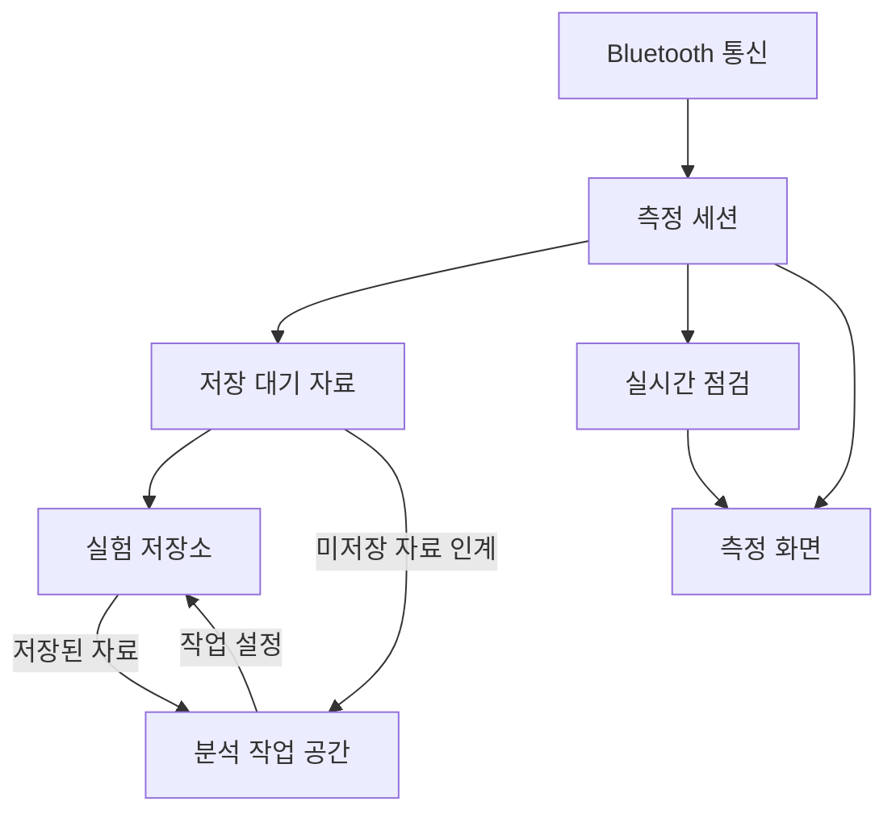

# 게이뤼삭 실험 초보자 모드 구현 설계

| 항목 | 내용 |
|---|---|
| 버전·작성일 | GL-DESIGN-v0.1 · 2026-10-11 |
| 기준 기획 | [PLAN.md](PLAN.md)의 확정 결정 D1–D5와 초기 범위 |
| 상태 | 구현 전 설계. 아래 파일·함수·메시지는 앞으로 구현할 계약이다. |
| 읽는 순서 | [화면과 행동](#2-화면과-행동) → [상태 전환](#3-상태-전환) → [모듈과 데이터](#4-모듈-경계) → [구현 순서](#10-구현-순서와-완료-기준) |

이 문서는 화면에서 일어난 행동을 어떤 모듈이 처리하고, 자료와 상태를 어떻게 보존할지 정한다. 기능의 목적·범위·학생 문구와 실시간 점검의 초기 수치는 [기획안](PLAN.md)을 기준으로 한다.

> [!IMPORTANT]
> **화면·통신·실험 기록의 수명을 분리한다.** 안내 화면을 다시 열어도 기록은 이어지고, 연결이 끊겨도 같은 실험이 남는다. 분석은 원자료와 학생의 작업 설정을 구분해 보존한다.

## 1 구현 경계

- 정적 HTML·CSS·JavaScript ES 모듈로 시작한다. 현재 저장소의 실행 방식에 맞춰 `/gay-lussac/`를 독립 진입점으로 두고 해시 경로를 사용한다. 기존 앱의 시작 구조는 [`../js/app.js`](../js/app.js)에서 확인할 수 있다.
- 화면 뼈대부터 최종 앱과 같은 코드를 사용한다. 최초에는 일부 기능을 연결하지 않은 상태로 화면 흐름을 확인하고, M1–M4에서 해당 모듈을 순서대로 채운다.
- 현재 배선 3D·Bluetooth 통신·차트 자원을 필요한 경계에서 재사용한다. 하위 앱은 자체 실험 상태와 저장소를 소유한다.
- 기준 환경은 기획안의 노트북·Chrome/Edge·micro:bit V2 조합이다. 앱 시작 시 연결·저장 기능의 이용 가능 여부를 확인하고 해당 기능 가까이에 안내한다.
- 개발용 자료 재생은 같은 표준 샘플 입력을 사용하되 별도 실험 ID와 `source=replay`를 붙인다. 실제 장치 수신과 실기 검증 여부를 구분한다.

## 2 화면과 행동

### 2.1 공통 틀

상단에 **기체의 온도와 압력**, 실험 이름, 연결·수신·저장 상태를 유지한다. 화면 중앙의 주된 내용과 하단의 행동만 준비·측정·분석에 맞춰 바꾼다. 상태 변화로 버튼 위치가 크게 이동하지 않도록 공간을 확보한다.

| 화면 | 넓은 화면의 기본 배치 | 주요 행동과 화면 반응 |
|---|---|---|
| 시작 | 실험 소개와 시작 행동, 저장된 실험 목록 | 처음부터 준비 / 장치가 준비되어 있어요 / 저장된 실험 열기 |
| 준비 | 왼쪽 약 2/3은 3D·전체 그림, 오른쪽은 현재 행동과 확인 | 한 번에 한 연결을 강조한다. 이전 단계와 **연결할 곳 보기**를 가까이 둔다. |
| 측정 | 상단 온도·압력, 중앙 시간 그래프, 아래 조작 버튼 | 가열 시작·물 추가·장치 변화·측정 마치기를 같은 위치에서 사용한다. |
| 분석 | 도구줄 아래 표와 그래프를 나란히 배치 | 자료 선택 → 원하는 도구 실행. 힌트는 그래프 옆의 접이식 영역에서 연다. |

작은 화면에서는 준비 설명을 모델 아래에 두고, 분석은 **표 / 그래프**를 전환한다. 선택한 행·축·그래프 상태는 유지한다. 실제 폭과 여백은 첫 화면 뼈대에서 확인한다.

### 2.2 화면별 상태

| 상황 | 보여 줄 내용 | 행동 결과 |
|---|---|---|
| 장치 연결 전 | 연결할 장치 그림, 연결 버튼 | 사용자 클릭으로 장치 선택을 연다. |
| 공식 전송 도구를 연 상태 | 받은 파일명, 돌아온 뒤 할 일 | 원래 탭의 단계는 유지한다. **전송했어요** 다음에 실제 수신을 확인한다. |
| 최초 수신 확인 | 새 온도·압력, 마지막 수신 시각 | 기록은 이미 준비 구간으로 시작된다. 배터리 전환과 용기 배치를 이어 안내한다. |
| 가열 전 | 준비 구간 그래프, **가열 시작** | 버튼을 누른 시각을 사건으로 남긴다. |
| 가열 중 | 같은 그래프와 조작 버튼, 필요한 점검 안내 | 물 추가·장치 변화는 측정을 계속하면서 기록한다. |
| 수신 중단 | 마지막 값과 시각, **다시 연결** | 오래된 숫자를 흐리게 표시하고 시간 그래프를 구간 경계에서 끊는다. |
| 저장 문제 | 미저장 자료 수, **다시 저장 / 파일로 보관** | 수신 자료를 메모리에 유지하고 저장을 재시도한다. |
| 분석 첫 진입 | 원자료 표, 자료와 축을 고르는 짧은 안내 | 학생이 그래프를 만든다. 힌트는 처음부터 닫아 둔다. |
| 분석 자료 부족 | 필요한 자료나 축을 안내 | 사용할 수 있는 다른 도구는 계속 사용할 수 있다. |

준비의 단계 표시와 **다음**은 장치 조작을 돕는 용도로 사용한다. 분석 도구는 독립적으로 열리며, 힌트를 읽은 횟수나 답변 여부에 연결하지 않는다. 버튼·표 선택은 키보드로도 조작하고 상태는 글자로 함께 전달한다.

## 3 상태 전환

### 3.1 따로 관리할 상태

| 상태 | 값 | 소유자 |
|---|---|---|
| 화면 | `home / prepare / measure / analysis` | 앱 제어기 |
| 실행 중 기록 | `idle / collecting / finishing / ended` | 측정 세션 |
| Bluetooth | `disconnected / connecting / connected` | 통신 어댑터 |
| 유효값 수신 | `waiting / receiving / stale` | 수신 점검 |
| 저장 | `clean / pending / saving / error` | 실험 저장소 |
| 저장된 실험 | `open / complete / interrupted` | `runs` 레코드 |

예를 들어 `Bluetooth=connected`, `수신=stale`, `저장=clean`이 동시에 가능하다. 화면에는 **장치는 연결되어 있지만 새 값이 들어오지 않음**, **지금까지의 자료는 저장됨**을 각각 표현한다.

### 3.2 전환 규칙

| 행동·사건 | 처리 |
|---|---|
| 새 실험 준비 | 실험 ID를 만들고 작성 권한을 확보한다. 준비 단계와 프로그램 후보 정보를 저장한다. |
| 최초 유효값 | 준비 구간부터 `collecting`으로 기록한다. 앞서 수신한 형식 오류는 오류 사건으로 남길 수 있다. |
| 안내 다시 보기 | 화면만 바꾼다. 세션·수신 콜백·저장 대기열을 유지한다. |
| 가열 시작 | `heating-start`를 한 번 기록한다. 버튼 중복 입력으로 사건을 복제하지 않는다. |
| 연결 해제 | 통신 자원을 정리하고 구간 종료를 기록한다. 기록 세션은 이어 연결할 수 있는 상태로 유지한다. |
| 같은 실험에 다시 연결 | 마지막 샘플 ID 다음부터 새 구간으로 기록한다. 재연결을 새 실험으로 처리하지 않는다. |
| 측정 마치기 | 입력을 먼저 마감해 `finishing`으로 바꾸고 종료 사건·남은 자료·완료 상태를 저장한다. 성공 또는 임시 분석 선택 후 `ended`로 이동한다. |
| 기록 중 분석 경로 진입 | **측정을 마치고 분석** 행동을 제시한다. 주소나 탭 변경만으로 측정을 끝내지 않는다. |
| 새로고침 후 미완료 기록 열기 | 저장된 부분을 보여 주고 **이어 측정 / 여기까지 분석**을 제공한다. 잠금 확보 후 중단 상태를 기록한다. |
| 완료된 실험 다시 열기 | 저장된 분석 작업을 복원한다. 추가 측정은 새 실험으로 시작한다. |

기록 중 다른 실험을 열거나 새 실험으로 바꾸려면 먼저 현재 측정을 마친다. 미저장 자료가 있는 경우 같은 앱 안에서 해당 메모리 자료를 인계하거나, 저장·내보내기를 처리한 뒤 바꾼다. 앱 제어기는 화면을 교체하면서 세션을 폐기하지 않는다.

## 4 모듈 경계

### 4.1 자료 흐름

분석 진입 시 저장된 자료와 미저장 자료를 한 스냅샷으로 합치는 책임은 앱 제어기와 실험 저장소에 둔다. 각 화면이 별도로 자료 배열을 만드는 방식을 피한다.

### 4.2 최소 모듈 계약

아래 함수 이름은 구현 시작점이다. 같은 책임을 유지하는 범위에서 파일 내부의 작은 함수를 나눌 수 있다. 전역 이벤트 시스템이나 플러그인 등록 체계는 초기 구조에 필요하지 않다.

| 위치·모듈 | 주요 계약 | 소유하는 상태 |
|---|---|---|
| `app.js` | `openRun(id)`, `navigate(screen)`, `finishAndAnalyze()` | 현재 실험, 화면, 세션과 화면의 연결 |
| `guide/steps.js`, `guide/viewer-adapter.js` | `getStep(id)`, `applyStep(step)`, `restoreStep()` | 안내 단계와 모델 표시 상태 |
| `measurement/transport.js` | `connect(onLine, onState)`, `disconnect()` | 장치, 연결 시도 번호, 수신 시작·정리 |
| `measurement/session.js` | `acceptLine(line, clocks)`, `markEvent(type, payload)`, `finish()` | 샘플 번호, 구간, 입력 마감, 실험 사건 |
| `diagnostics/` | `evaluateReceive(context)`, `evaluatePressureTrend(context)` | 규칙별 보류·의심·해제와 계산창 |
| `data/repository.js` | `commitBatch(batch)`, `openRun(id)`, `readSamples(id, range)`, `getSnapshot(id)` | 저장 대기열, 트랜잭션, 확정 위치, 작성 잠금 |
| `analysis/workspace.js` | `applySelection()`, `updateColumn()`, `setExcluded()`, `fitLine()`, `undo()` | 표 상태, 적용 자료, 계산·그래프 설정 |
| `analysis/calculations.js` | `evaluateColumns()`, `linearFit()` | 입력에서 계산한 결과. DOM·장치·DB에 의존하지 않음 |
| `data/files.js` | CSV·JSON 읽기/쓰기, 그래프 PNG 출력 | 형식 변환과 검증 |

화면은 사용자 행동을 해당 모듈에 전달하고 결과를 표시한다. 저장과 실시간 점검은 화면의 단계 번호를 입력 조건으로 사용하지 않는다.

## 5 3D 안내와 장치 연결

### 5.1 기존 3D의 최소 통합

[`../bmp280-wiring/index.html`](../bmp280-wiring/index.html)을 같은 출처의 iframe으로 한 번 생성해 유지한다. 구현 시 기존 페이지에 `embed=1` 표시 모드와 작은 `embed-bridge.js`를 추가한다. 이 파일은 기존 번들 바깥에서 정해진 UI 연결 지점만 호출한다.

| 기존 연결 지점 | 적용 방법 |
|---|---|
| `[data-view]`의 `iso/front/back/top/ports` | 준비 단계별 기본 시점을 적용한다. |
| `[data-wire]`의 `vcc/gnd/scl/sda` | 해당 선만 강조한다. 기존 동작은 토글이므로 이미 선택된 선을 다시 눌러 해제하지 않도록 현재 상태를 확인한다. |
| `#all-wires`, `#explode` | 전체 선 표시와 분리 정도를 명시적인 값으로 적용한다. |
| `#inspect-connectors` | 단자 확대와 분리값 변경이 함께 일어나는 동작으로 취급한다. |
| `#reset` | 전체 초기화에 사용한다. **연결할 곳 보기**는 현재 단계의 시점·강조·분리값을 다시 적용한다. |

임베드 모드는 기존 제목·사이드바의 표시만 조정하고 필요한 DOM은 유지한다. 프레임과 3D 영역의 높이를 정해 모델을 크게 표시한다. 일반 주소의 독립 안내도 계속 사용할 수 있도록 변경 범위를 한정한다.

<strong>새로 추가할 프레임 메시지 계약</strong>

- 메시지는 `channel: "gay-lussac-guide"`, `version: 1`, `type`, `requestId`를 갖는다.
- 부모의 준비 요청에 프레임은 `ready`를 응답한다. 단계 적용은 `apply-state`와 `{view, wire, explosion}`만 허용하고 `applied` 또는 `error`로 응답한다.
- `view`는 `iso/front/back/top/ports/connector`를 허용한다. `connector`는 `#inspect-connectors`에 대응하며 `explosion=60`인 상태로만 요청한다. 다른 시점은 해당 `[data-view]`에 대응한다.
- `wire`는 `null/vcc/gnd/scl/sda`를 허용한다. `null`은 **전체 배선 표시·강조 없음**이며 `#all-wires`에 대응한다. 특정 선은 전체 표시 상태에서 해당 선을 선택한다. `explosion`은 기존 모델 범위인 0–60으로 제한한다.
- 양쪽은 발신 출처와 상대 창을 확인한다. 임의 선택자·함수명·스크립트를 메시지로 받지 않는다. 부모는 마지막 요청과 다른 응답을 현재 단계 완료로 처리하지 않는다.
- 표시 적용 완료는 실제 배선 완료를 뜻하지 않는다. 실제 조작은 사용자가 확인한다.
- 자유 회전 뒤 **연결할 곳 보기**는 동일한 `apply-state`를 다시 보낸다. 프레임 통신·WebGL 이용이 어려우면 같은 단계의 정지 그림·연결표를 제공한다.

현재 모델의 `ports` 시점은 USB·전지 단자를 함께 보여 준다. 개별 포트 확대, 배선 양끝에 맞춘 카메라 이동, 부드러운 전환은 필요한 부분부터 추가할 작업이다. 현재 코드에 외부 제어 API가 이미 있다고 가정하지 않는다. 용기·수조·고정 장치 안내는 기획안대로 별도 전체 그림으로 보완한다.

### 5.2 공식 전송과 실제 수신

기획안의 [공식 USB 전송 경로](PLAN.md#3-3d-장치-준비와-공식-usb-전송)를 그대로 사용한다. `program-config.js` 한 곳에서 HEX 경로·표시 이름·버전·해시·센서 프로파일·검증 상태를 관리한다. 현재 HEX는 검증할 후보이며, 실물 확인 후 해당 조합을 기준으로 지정한다.

전송 버튼은 HEX 받기와 공식 도구 열기를 제공한다. 파일은 브라우저의 다운로드 위치에서 찾도록 파일명을 안내한다. 공식 도구의 완료 상태를 읽는 연동은 전제로 두지 않는다. 원래 앱에서 **새로운 유효값 3개가 1초 이상에 걸쳐 수신됨**을 확인하고, 배터리 전환 후 그 시점 이후의 값으로 다시 확인한다.

`transport.js`는 기존 [`../js/bluetooth.js`](../js/bluetooth.js)의 장치 선택·연결·알림·`bme` 명령·정리를 감싼다. 기존 연결 화면에 있는 첫 값 대기와 제한된 시작 명령 재시도는 세션과 분리해 옮긴다. 현재 기준인 첫 값 대기 3초, 명령 간격 300ms·최대 5회를 연결 설정으로 관리하고 M1 실기에서 적합성을 확인한다. [기존 연결 구현](../js/ui/connection-panel.js)

연결 시도 번호가 지난 응답·콜백·재시도를 무시하고, 종료 시 타이머와 알림을 정리한다. 연결 객체는 통신 어댑터가 소유하며 기존 전역 `state.history`나 연결 UI의 초기화 함수를 새 기록의 저장소로 사용하지 않는다.

## 6 데이터와 저장 계약

### 6.1 표준 데이터

| 레코드 | 필수 내용 | 규칙 |
|---|---|---|
| `Run` | `id`, 스키마 버전, 이름, 생성·갱신 시각, 상태, 프로그램·프로파일, 자료 출처, 구간 정보, 마지막 저장 샘플 ID | 초보자·후속 중급자 모두 같은 구조 사용 |
| `Sample` | `runId`, `sampleId`, `segmentId`, `receivedAt`, `segmentElapsedMs`, `temperatureC`, `pressureHpa`, `validity` | 샘플 ID는 실험 내 증가 정수. 원값은 추가 저장 |
| `Event` | `runId`, `eventId`, UTC 시각, `segmentId`, `segmentElapsedMs`, 종류, 내용, `source=user/system` | 가열·배치·장치 조작·수신 변화·점검·종료를 구분 |
| `Workspace` | `runId`, 작업 버전, 표 상태, 현재 선택 ID, 적용 후보 ID, 제외 사유, 계산 열, 축·회귀·메모 | 원자료와 별도로 자동 저장 |

`receivedAt`은 UTC 기준 Unix 밀리초이며 CSV에서는 ISO 시각으로 출력한다. 센서 내부의 정확한 측정 시각으로 부르지 않는다. `segmentElapsedMs`는 같은 실행 구간의 단조 경과시간으로, 점검창과 수신 지속시간을 재생할 때 사용한다. 단조 시계와 실제 UTC 시각의 차이는 [MDN의 시간 API 설명](https://developer.mozilla.org/en-US/docs/Web/API/Performance/now)을 따른다.

측정 중 사건에도 해당 구간 ID와 구간 경과시간을 함께 남겨 점검창에 대응시킨다. 아직 구간이 없는 준비 사건이나 구간 사이의 사건은 두 값을 `null`로 두고 UTC 시각과 발생 순서를 보존한다. 실험의 구간 정보에는 시간의 출처를 `monotonic / utc-derived`로 구분한다.

수신 파서는 프로파일이 정한 필드 수와 숫자 전체를 검사한다. 현재 3필드 파서의 `parseFloat`만으로 형식 검사를 끝내지 않는다. 파싱 가능한 범위 밖 원값은 필드별 `validity`와 함께 보존하고, 파싱 불가능한 수신은 시각·오류 종류를 남긴다. BMP280 프로파일에서 측정하지 않는 습도는 유효한 센서값으로 노출하지 않는다. [기존 파서](../js/utils/parseSample.js)

### 6.2 연속 구간

재연결, 새로고침 뒤 측정 재개, 유효값 장기 공백, 시각 역행, 브라우저 정지·재개로 연속성을 확인할 수 없는 때에는 다음 유효값부터 새 `segmentId`를 부여한다. UTC 시각과 단조 시계의 차이가 크게 달라진 경우도 시각 불연속 사건으로 남긴다.

최근 60초 표시는 실제 수신 경과시간으로 계산한다. 전체 시간 그래프는 UTC 수신 시각에 따른 경과시간을 표시하되 구간 사이의 선을 끊는다. 시각이 변경된 구간은 표시하고, 공백을 보간하거나 0으로 채우지 않는다. 점검창은 같은 연속 구간 안에서만 구성한다.

### 6.3 IndexedDB와 저장 대기열

DB 이름 `bme280.gay-lussac`, 버전 `1`, 저장소 `runs / samples / events / workspaces`를 사용한다. `samples` 키는 `[runId, sampleId]`, `events` 키는 `[runId, eventId]`, 작업 공간 키는 `runId`로 둔다. 샘플은 실험·구간별로 읽을 수 있게 인덱스를 둔다.

1. 수신 시 표준 샘플 ID를 부여하고 저장 대기열에 추가한다. 최근 화면용 자료와 미저장 자료를 구분한다.
2. 정상 동작 시 최대 약 1초 주기로 대기 묶음을 저장 요청한다. 한 실험의 쓰기는 직렬화한다.
3. `commitBatch()`는 해당 묶음의 샘플·사건·실험 메타데이터와 필요한 작업 변경을 같은 트랜잭션으로 기록한다.
4. 트랜잭션 완료 후에만 확정 위치를 갱신하고 **그 묶음의 ID만** 대기열에서 제거한다. 저장 도중 새로 도착한 자료는 다음 묶음에 남긴다.
5. 실패하면 같은 ID로 재시도한다. 이미 저장된 자료와 충돌할 경우 내용을 확인하고 원자료를 덮어쓰지 않는다.

`clean`은 대기 자료와 작업 변경이 모두 확정된 상태다. 요청 하나의 성공과 전체 트랜잭션 완료를 구분하고, DB 작업 중 네트워크·UI 응답을 기다리지 않는다. 저장 수명과 트랜잭션 완료 기준은 [IndexedDB 문서](https://developer.mozilla.org/en-US/docs/Web/API/IndexedDB_API/Using_IndexedDB)를 따른다.

### 6.4 측정 종료와 임시 분석

**측정 마치기**는 입력을 닫고 종료 시점의 자료를 고정한다. 종료 사건과 남은 자료, `Run.status=complete`를 같은 트랜잭션으로 저장한 뒤 분석을 연다. 중복 클릭은 같은 종료 요청으로 처리한다.

실패하면 **저장 다시 시도 / 임시 자료로 분석**을 제공한다. `getSnapshot(runId)`는 저장된 자료와 메모리의 미저장 묶음을 ID로 합쳐 중복 없이 반환한다. 분석과 파일 내보내기는 이 스냅샷을 함께 사용한다. 저장소만 새로 읽는 화면 이동으로 임시 자료를 잃지 않도록 앱 제어기가 해당 버퍼를 유지한다.

임시 분석에는 **미저장 자료가 있음**과 대기 건수를 표시하고, 분석 작업 변경도 미저장으로 관리한다. 메모리 자료의 저장이 끝나면 같은 실험을 저장된 상태로 전환한다. 새로고침 복원은 마지막 완료 트랜잭션까지이며, 새로 열린 앱은 미완료 저장분이 복원되었다고 표시하지 않는다.

### 6.5 한 실험의 작성 권한

`bme280.gay-lussac:run:<id>` 이름의 Web Lock을 잡은 탭만 해당 실험을 측정·수정한다. 잠금은 측정에서 분석으로 넘어가도 유지하고, 실험을 닫을 때 해제한다. 같은 출처의 이름별 잠금 동작은 [Web Locks 문서](https://developer.mozilla.org/en-US/docs/Web/API/Web_Locks_API)에 근거한다.

두 번째 탭은 `ifAvailable` 방식으로 잠금 실패를 확인한 뒤 읽기 상태로 연다. 원자료 보기와 내보내기를 제공하고 미완료 상태·분석 작업을 덮어쓰지 않는다. 작성 권한 재시도는 사용자 행동으로 수행한다. 임시 자료만 남은 실험은 버퍼를 보유한 탭에서 계속 다룬다.

## 7 학생 주도 분석의 동작 계약

### 7.1 표 상태와 적용 자료

| 집합·상태 | 의미 | 바뀌는 행동 |
|---|---|---|
| 표 보기 | 정렬·필터·페이지 | 표 조작 |
| 현재 선택 ID | 지금 체크하거나 범위 선택한 행 | 클릭·범위 선택·전체 선택 |
| 적용 후보 ID | 그래프·계산에 적용한 자료 범위 | **선택 자료 적용**, **전체 자료 적용** |
| 제외 ID와 사유 | 후보 중 분석에서 제외한 행 | 분석에서 제외·복원 |
| 실제 유효점 | 후보에서 제외 행을 뺀 뒤 필요한 열 값이 유효한 점 | 자료·축·계산 열이 바뀔 때 계산 |

표의 행 번호와 샘플 ID를 분리한다. 선택은 정렬·필터·페이지 이동 뒤에도 ID로 유지한다. **전체 선택**은 현재 필터에 해당하는 모든 페이지의 행을 뜻하며 건수를 표시한다. 숨겨진 선택 행이 있으면 선택 수와 현재 표에 보이는 선택 수를 함께 보여 준다.

자료를 제외해도 적용 후보 ID를 지우지 않는다. 복원하면 같은 범위로 돌아온다. 그래프에는 후보 수·사용 점 수·제외 수·값 부족 수를 구분해 표시한다. 필드 유효성에 문제가 있는 행은 표에서 확인할 수 있으며 필요한 값이 유효한 계산에만 사용한다.

### 7.2 계산 열과 그래프

계산 열 정의는 `id`, `name`, `unit`, `lhs`, `op`, `rhs`로 둔다. 입력은 열 ID 또는 상수, 연산은 `+ / − / × / ÷`이다. **절대온도**와 **압력/절대온도**는 이 정의를 만들어 주는 프리셋으로 구현한다.

계산 열이 다른 계산 열을 참조할 수 있도록 하되 참조가 한 방향으로 이어지는지 확인한다. 순환 참조·삭제된 입력·분모 0·유효하지 않은 숫자는 이유가 있는 빈 결과로 처리한다. 입력·출력 단위를 보여 주며 임의 코드를 실행하는 수식 처리는 사용하지 않는다.

그래프 만들기는 적용할 자료와 X·Y축을 확정한다. 산점도가 기본이고 시간축에서는 구간별 시간 변화선을 선택할 수 있다. 회귀는 현재 그래프의 동일한 실제 유효점을 사용한다. 표시를 위해 점을 줄여 그리는 경우에도 계산·내보내기의 원자료 범위는 유지한다.

### 7.3 회귀 결과와 변경 처리

`linearFit()`은 사용 점 수, 회귀식 계수, R², x절편의 상태와 이유를 따로 반환한다. 서로 다른 X값이 2개 이상 필요하며, 기울기 0의 회귀선과 y절편도 유효할 수 있다. Y가 일정하면 R²의 계산 불가 이유를 표시한다.

x절편 `−b/a`는 기울기 0·비유한 결과·수치적으로 불안정한 나눗셈에서 보류한다. 수치 오차 허용값은 축의 크기에 맞춰 계산 엔진에 두고 검증 자료로 확인한다. 작은 기울기라는 이유로 원래 회귀선까지 없애지 않는다. 절대영도 표시는 섭씨온도 X축·압력 Y축일 때 학생이 직선 연장을 선택해 연다. 측정 범위와 연장선을 구분하며 R²로 실험 성공을 판정하지 않는다.

| 변경 | 그래프·회귀의 처리 |
|---|---|
| 정렬·필터·현재 행 선택·메모 | 기존 적용 자료와 회귀 유지 |
| 새 범위 적용·제외/복원·계산 열 수정·축 변경 | 그래프 갱신, 회귀·외삽은 **다시 계산 필요** |
| 직선 맞추기 | 현재 입력 버전에 대한 회귀 저장 |
| 되돌리기·다시 실행 | 작업 정의 복원. 계산 입력이 바뀌면 회귀 상태도 갱신 |

작업 공간은 계산 입력 버전과 회귀가 사용한 버전을 함께 저장한다. 저장된 결과의 버전이 맞지 않으면 이전 식을 현재 그래프의 결과로 표시하지 않는다. 되돌리기 이력은 현재 세션에서 유지하고, 재접속 시에는 저장된 현재 작업 상태를 복원한다.

## 8 실시간 점검의 연결

수신 점검과 압력 반응 점검은 별도 함수·설정으로 둔다. 입력은 표준 샘플·단조 경과시간·연속 구간·배치/가열/장치 사건이며, 출력은 `ruleId`, `ruleVersion`, `state`, `reasonCode`, `evidence`이다. UI 문구는 `reasonCode`에 대응하는 문구표에서 가져온다.

| 규칙 | 상태와 입력 처리 |
|---|---|
| 수신 | 최초 대기, 수신 중, 중단을 구분한다. 형식이 틀린 수신과 정상적인 같은 값 반복을 구분한다. |
| 압력 반응 | `pending / observing / suspected`를 기본으로 한다. 판단·해제 근거가 부족하면 `pending`으로 두고 과거 의심 기록을 유지한다. |

압력 반응의 계산식·시간창·상승폭·의심/해제 수치는 [PLAN.md §5](PLAN.md#5-실시간-상태-확인과-누설-의심-안내)의 미검증 초기 설정을 한 설정 파일로 옮긴다. 수치를 이 문서에서 다시 정의하지 않는다.

배치 확인 뒤 기준 구간을 모으고 가열 사건 뒤 추세를 평가한다. 새 구간, 범위 밖 값, 파싱 오류, 알려진 장치 이동은 계산창을 초기화한다. 뚜껑 열림 뒤에는 **다시 밀폐** 기록부터 기준값을 새로 모은다. 물 추가는 가열 중 조작으로 기록한다.

점검은 기록을 멈추거나 분석 행을 제외하지 않는다. 화면 표시와 사건 저장은 상태가 바뀔 때 수행하고, 근거 시간창·계산값·설정 버전을 남긴다. 이후 사용자가 사건 내용을 수정해도 당시 점검 기록은 당시 근거로 보존한다.

## 9 파일과 복원

| 파일 | 구현 계약 |
|---|---|
| 전체 CSV | 샘플 ID·구간·구간 경과시간·시간 출처·UTC 시각·온도·압력·유효성 표시를 포함한다. 기존 주요 열 이름 `timestamp / temperature_c / pressure_hpa`를 유지한다. |
| 선택 자료 CSV | 선택 범위에도 기본 원자료 열을 항상 포함하고 선택한 계산 열을 덧붙인다. 제외·유효성 처리와 실제 내보낸 행 수를 표시한다. |
| 전체 실험 JSON | 스키마 버전과 실험·샘플·사건·현재 작업 상태를 담는다. 장치 객체·DB 핸들·탭 잠금은 포함하지 않는다. |
| 그래프 PNG | 현재 그래프의 축·단위·범위를 포함한다. |

CSV는 실제 스프레드시트에서 읽을 수 있도록 UTF-8 BOM과 따옴표·쉼표·줄바꿈 처리를 적용한다. 불러오기는 기획안의 두 CSV 형식과 전체 실험 JSON을 지원한다. 기존 CSV에 없는 사건은 비어 있는 상태로 두고, 행마다 샘플 ID를 부여한다.

신규 CSV의 구간 경과시간과 시간 출처를 보존한다. 구형 CSV는 행 순서·수신 시각으로 구간 경과시간을 유도하고 `timeBasis=utc-derived`로 표시한다. 시각 역행·긴 공백에서는 구간을 나누며, 유도한 시간을 보존된 단조 시각처럼 취급하지 않는다. 선택 CSV는 내보낸 부분 자료로 다시 열고 원래 전체 실험을 복원한 것으로 표시하지 않는다.

JSON은 스키마·숫자·ID 참조·계산 열 의존성을 먼저 확인한 뒤 저장한다. 실험 ID가 충돌하면 새 ID로 가져오고 자식 레코드의 실험 ID도 함께 바꾼 뒤 출처 ID를 기록한다. 원자료·사건·작업과 원래 완료/중단 상태를 보존하되 활성 통신이나 탭 잠금은 복원하지 않는다. 미완료 자료를 이어 측정하려면 작성 권한과 새 연결을 확보하는 기존 재개 절차를 따른다.

파일 내보내기와 저장소 인계는 같은 스냅샷을 사용한다. 브라우저의 다운로드 요청과 외부 파일 저장 완료는 별개로 안내한다. 다른 기기·출처로 옮기는 경로와 저장 범위는 [기획안 §6·§8](PLAN.md#6-브라우저-저장과-측정-분석-연결)을 따른다.

## 10 구현 순서와 완료 기준

### 10.1 문서 다음에 할 일

| 단계 | 작업 순서 | 완료 기준 |
|---|---|---|
| M1 화면과 연결 뼈대 | 앱의 세 화면·공통 상태 → 최소 연결 화면과 프로그램 설정 → 3D 어댑터와 준비 안내 → 저장소 스키마 | 공식 도구 전송, 실제 BMP280 값, USB 분리 후 배터리 수신을 같은 흐름에서 확인한다. 준비·측정·분석 화면의 초점과 주요 행동을 화면에서 검토한다. |
| M2 측정과 저장 | 세션·구간 → 작은 묶음 저장 → 사건·수신 중단/복구 → 측정 종료 인계 → 전체 CSV | 재연결·화면 이동 뒤 원자료가 이어지고 저장된 같은 실험을 분석에서 읽는다. 저장 실패 자료도 임시 분석·CSV로 접근한다. |
| M3 자유 분석 | 표와 선택 집합 → 계산 열 → 그래프·회귀 → 제외·복원·되돌리기 → 나머지 파일 입출력 | 학생이 자료와 도구를 자유롭게 적용하고 작업을 다시 연다. 입력 변경 뒤 이전 결과가 섞이지 않는다. |
| M4 기본 추세와 사용 흐름 | 누설 의심·보류·해제 → 근거 저장 → 추가 실험 자료 재생 → 처음부터 끝까지 사용 | 수신 중단·냉각·변화 부족을 구분하고 실제 자료에서 의심 안내를 검토한다. 초보 사용자가 막히는 화면을 수정한다. |

전체 CSV는 M2에서 먼저 제공해 분석 도구가 개발 중일 때도 측정 자료를 스프레드시트에서 사용할 수 있게 한다. 기획안의 전체 기능 범위는 유지한다.

공식 전송과 배터리 수신의 실물 확인은 M1의 최소 연결 화면이 생기는 즉시 수행한다. 화면 연출을 다 만든 뒤로 미루지 않는다. 실물 확인을 기다리는 동안 저장·분석은 재생 자료로 구현할 수 있으며 실기 확인 상태는 별도로 남긴다.

### 10.2 필요한 검증

| 변경 영역 | 확인할 핵심 사례 |
|---|---|
| 3D 연결 | 단계 반복 적용으로 강조가 풀리지 않음, 현재 단계 복귀, 독립 안내·임베드 화면의 필요한 동작 |
| 통신과 세션 | 최초 수신, 오래된 콜백, 단절·재연결, 배터리 전환, 중복 종료 |
| 저장과 복원 | 저장 도중 새 수신, 실패 후 재시도, 미저장 스냅샷, 새로고침, 두 탭의 같은 실험 쓰기 |
| 분석 | 알려진 계산 결과, 분모 0, 일정한 X/Y, 기울기 0, 선택·필터·제외·복원, 결과 버전 불일치 |
| 점검 | 정상 비례/작은 압력 반응의 합성자료, 냉각·작은 변화·수신 공백, 실제 추가 자료 |
| 파일 | CSV를 스프레드시트에서 읽기, JSON 왕복 후 ID·원자료·사건·작업 대응 |

변경한 모듈과 그 연결 부분을 확인하고, 마지막에는 준비부터 저장·분석까지 한 차례 이어서 사용한다. 이미 확인한 개별 검사를 단계마다 전부 반복하지 않는다. 처음 사용하는 교사나 학생이 어느 화면에서 추가 설명을 필요로 했는지 기록해 안내를 보완한다.

> [!NOTE]
> 구현 중에는 이 문서의 계약과 완료 기준을 함께 갱신한다. 사용자 경험이나 기능 범위를 바꾸는 결정은 기획안에도 반영하고, 세부 배치·함수 분해·표현 조정은 구현과 함께 정한다.

## 11 근거와 현재 확인 범위

기존 코드 검토 기준은 [`f6b7e43`](https://github.com/Cho-WH/bme280/commit/f6b7e431e89e166f7af1ab8ca40bf7e74a24a8d4)이다. 기존 기능과 앞으로 추가할 연결 기능을 구분해서 기술했다. 현재 단계는 문서·코드 읽기이며, 프레임 통합·실제 전송·저장·분석 동작의 구현 검증은 M1–M4에서 수행한다.

- 사용자 결정·물리적 해석·공식 도구·저장 범위: [PLAN.md](PLAN.md).
- 실제 통신 API와 연결 수명: [`bluetooth.js`](../js/bluetooth.js), [`connection-panel.js`](../js/ui/connection-panel.js), [`state.js`](../js/state.js).
- 현재 입력·내보내기 형식: [`parseSample.js`](../js/utils/parseSample.js), [`csv.js`](../js/utils/csv.js).
- 기존 3D의 UI 연결 지점: [`bmp280-wiring/index.html`](../bmp280-wiring/index.html).
- 브라우저 저장 계약: [Using IndexedDB](https://developer.mozilla.org/en-US/docs/Web/API/IndexedDB_API/Using_IndexedDB), [Web Locks API](https://developer.mozilla.org/en-US/docs/Web/API/Web_Locks_API).
- 시간 기준: [Performance.now](https://developer.mozilla.org/en-US/docs/Web/API/Performance/now). 운영체제 절전 중 시간 진행 차이를 고려해 브라우저 재개 시 연속성을 다시 확인한다.
